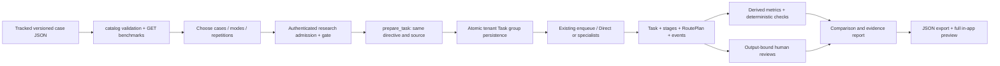

# Benchmark and Research Lab data flow — 2026-10-09

## Presentation explanation

A benchmark is a controlled assignment used to compare how the application executes the same input in Single, Fixed and Adaptive modes. It is not model training. Research Lab saves each trial, shows what actually ran, computes limited checks and descriptive measurements, and allows a human to score the saved answer. The project demonstrates orchestration, provenance, measurement and human evaluation. Fixture answers demonstrate that machinery; they do not demonstrate a better or cheaper AI model.

There are **two distinct benchmark systems**, plus ordinary uploaded inputs. They share the Task execution engine but are not interchangeable.

| Data category | Physical source | SQL persistence | Consumer |
|---|---|---|---|
| Six employee/HR size datasets | Private, ignored `data/benchmark/{employee,hr}_{small,medium,large}.json` (or configured directory) | `dataset_registry` stores metadata only; a selected run stores dataset ID/checksum and bounded aggregate context in `simulations.payload` | Optional dataset selection in simulation composer / matched experiments. |
| Seven Research Lab cases | Tracked `backend/database/benchmarks/research-v1.json` | Original registry is file-based; each admitted Task saves complete case/check/version snapshot and hash in `simulations.payload.research` | Research Lab case selection, controlled admission, quality checks and comparisons. |
| Input directives/source material | Case directive plus inline `Source:` text, or ordinary user directive/upload | Original directive, prepared input, input fingerprint, source snapshots in Task JSON and projections | Direct/specialist prompts; routing sees input capabilities and task type. |
| Reference criteria | Case `checks`, with expected strings/numeric fields; seven-dimensional human rubric | Included in pinned case/research metadata and report; outcomes derived from saved outputs | Deterministic evaluator and human assessors. |
| Execution evidence | Existing Task, StageExecution, RoutePlan, messages/events/model/usage | `simulations`, `tasks`, `agent_executions`, messages/events/metrics tables | History, inspector, comparison/report. |
| Evaluation results | Derived surface checks, observed metrics, human assessment; optional judge | Human reviews and optional evaluation stored in Task JSON; comparison derived on read | Research tables, individual trial view, report/export. |
| Portable historical report | `docs/acceptance/phase9-fixture-report.json`, phase10 equivalent, exported reports | Not automatically imported into SQL or browser history | Read-only academic demonstration and independent inspection. |

## Six employee/HR file datasets: real use and limitations

`backend/app/datasets/registry.py` defines strict schemas, families/size variants, safe/protected/confidential fields, checksum validation, prefix validation and `context_for_dataset`. `datasets/cli.py` implements explicit server-side registration. `api/routes/datasets.py` exposes GET `/api/v1/datasets` and `/{id}` for metadata; registration is not a public upload/write API. Startup does not automatically import the six files.

This task validated all existing local files into a disposable SQLite repository; no private row values were reported:

| File identity | Rows | Prepared safe context length |
|---|---:|---:|
| employee_small | 294 | 523 characters |
| employee_medium | 735 | 531 |
| employee_large | 1470 | 536 |
| hr_small | 62 | 584 |
| hr_medium | 155 | 604 |
| hr_large | 311 | 614 |

Validation checks non-empty arrays, exact columns/types, distinct employee IDs, positive salary, age/tenure validity, bounded non-empty strings, nonfinite values and nested prefix variants. HR ManagerID NaN is normalized to null for validation. File-byte SHA-256 fingerprints and quality metadata are saved; raw rows stay on disk. Safe prepared context contains aggregate Department/JobRole/JobLevel/YearsAtCompany or Status distributions, at most 12 category values and 3,500 characters. Names, IDs, salaries, manager links, age, gender and performance ratings do not enter this context. Privacy depends on those source fields being curated; aggregates themselves are not a formal anonymization guarantee.

`api/routes/tasks.py:prepare_task` reads the selected registry row and reopens/revalidates the file, requires matching checksum/active state, then pins prepared aggregate context and checksum into Task/provenance. Missing registry returns 404; absent/changed/invalid file returns 422 before admission. `_prepared_context` and specialist/direct prompts consume the bounded context. Adaptive routing recognizes structured benchmark context (`agents/routing.py:plan_route`), which can add structure/analyze capabilities. It does not inspect confidential raw rows. Single/Fixed use the same prepared inputs but their execution sequences are prescribed.

These datasets therefore have implemented purpose and functional local consumers; **they are not merely UI labels**. They are not hiring requirements, role knowledge, candidates or a recruitment database. Large variants do not make the LLM process every employee row: aggregate preparation bounds prompt size. Do not present this as raw-row throughput/accuracy benchmarking. Current private file provisioning and registration in Railway were not checked; metadata in PostgreSQL alone cannot reproduce a missing raw file. See `data/benchmark/README.md` and historical `docs/PHASE2_DATABASE_DEPLOYMENT.md`.

## Seven Research Lab cases

`experiments/research.py:catalog` loads and Pydantic-validates the file on catalog/admission, checks unique identities, and returns a version-1 suite. `models/schemas.py:BenchmarkCase.execution_directive` concatenates the original directive and `\n\nSource:\n` material. **Only this assignment and source enter the execution directive; expected check values are evaluator metadata, not an answer provided separately to the agent.** All modes receive equivalent input; source and checks are pinned in the persisted trial snapshot.

| Case | Assignment and source | Actual machine check / limitation |
|---|---|---|
| B-direct | Expand RTO from supplied glossary | Case-insensitive trimmed exact `recovery time objective`; narrow reference answer. |
| B-synthesis | Combine Cedar/Mira/May and Maple/Ravi/June notes | Contains all six strings; cannot establish relationships/reasoning are correct. |
| B-data | Total and average Monday 10, Tuesday 20, Wednesday 30 requests; numeric JSON only | Exact key set `{total,average}`, numeric values 60 and 20; JSON parse/type/values checked. |
| B-analytical | Compare Plan A monthly 20+1/request and Plan B 50+0.5/request at 100 requests/month | Contains 1440,1200,240 and Plan B; a text match can still be embedded in incorrect reasoning. |
| B-summary | Compress launch 15 May, supplier delay, backup supplier | Contains three critical facts; deterministic check does not enforce the stated maximum sentence count or all semantics. |
| B-report | Findings/Risks/Recommendation for 40-ticket pilot, six open, staffing limit, one-week extension | Two surface checks: headings and fact strings. The literal `six` may miss a semantically equivalent `6`. |
| B-mixed | Ada prepares, Ben validates after Ada, Cy publishes after Ben | Two checks: requested headings and owner names; dependency correctness needs human review. |

They cover bounded direct answers, synthesis, arithmetic/structured output, analysis, summarization, reporting and mixed transformation. These are synthetic, safe academic demonstration cases, **not a representative domain accuracy dataset**. Source/context can influence Adaptive capability routing and case task type is explicitly passed. Expected answer rules, evaluation scores and historical winners do not train or adapt routing. `agents/routing.py` selects matching specialist capabilities by rules; no learned optimizer or fine-tuning path exists.

## End-to-end Research Lab flow

1. `api/routes/experiments.py:get_benchmarks` requires simulation-view permission and returns cases, rubric, configuration, max runs/repetitions and execution gate. Frontend `pages/ResearchLab.jsx` renders actual definitions, selection, admission and saved results via `services/apiClient.js`.
2. `ResearchExperimentInput` forbids extra authority fields, duplicate/unknown IDs or modes, invalid version/repetitions; 1–5 repetitions and at most 45 trials. Case×mode×repetition is the trial count. Seven cases×three modes×two repetitions = 42 trials; three repetitions of the complete suite exceeds the 45-run bound.
3. `admit_research` requires live gate and simulation-create permission, validates cases/modes, pins provider/models/output token limit/runtime/dependency versions/implementation and fixture hashes, prepares all trials before atomic `Repository.save_research_group`. Every Task stores all expected run IDs and immutable experiment metadata; there is **no `experiments` or `research_results` physical table**.
4. Existing enqueue/BackgroundTasks executes sequentially, rotating mode order each repetition. Single calls Direct; Fixed executes Research→Data→Analysis→Summarizer→Report; Adaptive records a validated RoutePlan and selected/skipped specialists, then executes dependency order ending with Report. Research Agent uses supplied source/available knowledge and cannot claim live web search. No second execution/evaluation engine is created.
5. Worker rechecks configuration/gate and live workspace authority before invocation and evidence acceptance. Per-agent model/token configuration is pinned through the central `call_llm` adapter/ContextVar. Checkpoint graphs are optional and default off; sequential execution is functional. Source/output contract and original intent stay authoritative across handoffs.
6. Repository saves complete Task JSON and relational projections in tenant transactions before client notifications. The main payload holds research/config/input fingerprints/RoutePlan and human reviews; `agent_executions` holds ordered stage evidence. Restart recovery marks/reconciles interrupted existing tasks under its established policy; no fabricated completion. Pending/failed/missing trials remain visible as such.
7. `/research/{id}` derives metrics/comparison from saved runs, checks metadata/directive/source fingerprints and all expected IDs, and blocks comparability for missing/inconsistent evidence. Rerun requires complete comparable evidence and identical active benchmark/configuration; it makes new IDs and a parent link rather than copying old outputs/reviews.
8. Human review requires simulation-evaluate permission, a completed run, matching output SHA-256 and expected review count. Seven integer 1–5 scores plus notes are attributed to current reviewer/time, appended (up to 50 per run) and retained in Task JSON. Stale/conflicting writes return 409 rather than replace another assessment.
9. Report requires simulation-export permission and includes observedEvidence, full runEvidence, interpretation, limited conclusion and reproduction metadata. UI offers JSON download and a full read-only report preview; neither requires starting paid execution.

Endpoints under `/api/v1/experiments`: GET `/benchmarks`, POST/GET `/research`, GET `/research/{id}`, POST `/{id}/rerun`, POST `/{id}/runs/{taskId}/human-review`, GET `/{id}/report`. Ordinary `/matched` is a separate three-mode admission path accepting user directive/dataset/uploads; it is not the versioned Research Lab catalog protocol. Its per-task enqueue loop is not Research Lab's atomic group admission.

## What is actually measured

`experiments/research.py:deterministic_quality/run_metrics/comparison/report` derives these fields from saved evidence:

| Metric | Implemented measure | Honest interpretation |
|---|---|---|
| Quality checks | Equal-weight pass fraction of exact/contains/excludes/numeric JSON checks | Surface/reference conformance, not general semantic accuracy. Current suite uses exact/contains/json_fields. |
| Human quality | Seven-dimension mean and original scores/rationale | Subjective human judgment; correctness, relevance, completeness, clarity, groundedness, concision, source consistency. No inter-rater agreement collected automatically. |
| Timing | Run elapsed seconds and stage durations | Execution/persistence overhead included; queue wait excluded. Fixtures' local timing is not real Groq latency. |
| Calls/handoffs | Recorded stage starts, persisted messages | Stage starts do not prove a provider request reached Groq. Provider-internal retries remain unknown. |
| Tokens | Saved provider usage with complete/partial/unavailable coverage; actual zero retained | Missing/partial usage is not imputed or included as complete totals. Repeated starts make per-attempt usage coverage uncertain. |
| Routing | Selected/skipped IDs, length, variants and modal-route frequency | Avoided stages are recorded; not proof they were unnecessary or quality was equal. |
| Reliability | Terminal success/failure rates, failure stages, explicit timeout and recovery events | Denominators expose expected/recorded/terminal counts. Sanitized provider errors can conceal timeout reasons. |
| Descriptive summaries | n, mean, median, min/max, sample SD only for n≥2 | 1–5 trials per case/mode; no confidence intervals, significance, global winner or causal superiority conclusion. |
| Cost | `null` | No pricing/cost superiority computed. |
| Model judge | Optional saved Groq rubric judgment via `experiments/evaluation.py` | Non-authoritative and separately gated for research; no judge/provider call in this task. |

## Why it appears unusable and the smallest useful next step

Default `RESEARCH_LIVE_ENABLED=False` causes admission/rerun to return 403 and the UI to disable Start/Rerun. `RESEARCH_JUDGE_ENABLED=False` also prohibits research judge calls. A provider key alone does not authorize/enable research. These code defaults and UI behavior were verified; current deployed settings were not read. Generic simulations and HR assistance have their own provider paths and are not rendered free/safe by the research gate.

The reading, comparison, review and export paths are implemented. An empty workspace contains no experiment trials to inspect; old fixture report files do not populate its database. The current empty-state text offers selecting a first comparison even when admission is disabled, which can feel contradictory. There is no bundled report-import or read-only sample-report screen. Therefore the correct conclusion is **functional workflow with controlled execution disabled by default**, rather than a missing database.

Smallest demonstration: open existing `docs/acceptance/phase10-fixture-report.json` read-only and explain the 42 retained synthetic trials, original directives, outputs, stage evidence and checks. It was structurally inspected in this task and is marked deterministic_fixture; historical timings/results were not presented as newly run live evidence. For interactive demo, explicitly use existing disposable acceptance tooling (`backend/scripts/research_acceptance.py --output /private/tmp/fm-research-demo.json`, or `backend/tests/phase10_browser_fixture.py`), which patches SDK before admission and writes only a temporary database. Never enable the deployed gate solely to make a button clickable. Focused current research tests already exercised real admission/persistence/comparison with mocked SDK; no separate 42-trial run was necessary here.

Recommended small follow-up UI changes: explain “view saved history while execution is disabled” in the empty state, and optionally provide a clearly labelled local read-only sample report view. A sample is not a new production experiment or fake provider output. Local fixture runtime is adequate for academic mechanics; scientific AI quality/latency/cost claims need separately approved live trials, broader versioned cases, stronger semantic/human evaluation and a suitable sampling plan.

## Failure, access and preservation

All research records share existing authenticated workspace IAM and tenant transactions/FORCE RLS. Failed provider/contract/authorization attempts retain honest failure events/outputs only as existing engine policy permits; no successful answer is fabricated. Group admission failure is atomic; failures after admission remain identifiable trials. Uncertain creation responses require reload before retry, not blind duplicate admission. Workspace/account changes remount/discard stale frontend state. A tenant owner may soft-delete/restore and explicitly purge run evidence under current lifecycle; missing trials invalidate comparability and complete purge removes the group. Export snapshots preserve only what was exported; they are not a backup schedule or authoritative SQL history.

Verification: six real local file variants validated/registered into isolated SQLite; 216 focused storage/HR/research/security tests passed; 26 opt-in local PostgreSQL tests skipped with no restricted URL. No live Google/Groq, paid calls, production SQL, configuration or deployments. See [DATABASE_ARCHITECTURE_AUDIT.md](DATABASE_ARCHITECTURE_AUDIT.md) and [OAUTH_RELIABILITY_AUDIT.md](OAUTH_RELIABILITY_AUDIT.md).
