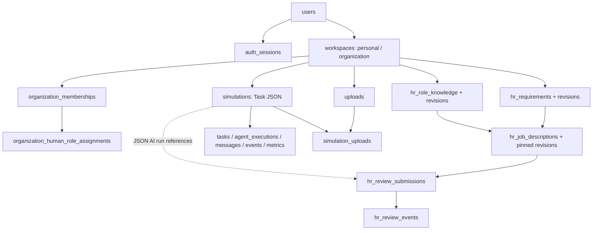

# Database architecture audit — 2026-10-09

Scope: code at `cc96b6d6f2b409a275aa50dc80d6db3784902abc` and the local OAuth corrections in this task. No production SQL, secrets, environment changes, migration execution, push or deployment. Code declarations are distinguished from live infrastructure verification.

## Decision in plain language

**HR Hiring already has a database-backed implementation. Keep option C: dedicated HR tables in the existing tenant-aware application database.** A screen named “HR Hiring,” an employee JSON file, and Research Lab are features/data sources, not additional PostgreSQL instances. SQLite is the local fallback; the same repository uses PostgreSQL for the declared Railway production architecture. Adding another HR database or schema has no demonstrated benefit for this project's current JD workflow.

Think of one filing cabinet with separate folders: identity, organization access, simulation evidence, hiring requirements, role knowledge, job descriptions and review decisions. Every organization-owned folder carries its workspace ID. PostgreSQL policies and application permissions check who can open and change it. A new JD version is a new preserved page, and an approval signs one exact page rather than all future edits.

## Physical systems and connections

| Storage | Code-confirmed configuration | Physical/live verification |
|---|---|---|
| Application database | One `Repository(settings.DATABASE_URL)`; SQLAlchemy Core, JSON on SQLite / JSONB variant on PostgreSQL; psycopg driver; `pool_pre_ping`; SQLite foreign keys enabled | One application connection setting, not proof of a currently attached production instance count. Railway PostgreSQL is declared; actual production binding/role/catalog not inspected. |
| Local fallback | `sqlite:///./simulator.db`; relative to backend process working directory | Read-only metadata inspection found **two existing local files**, root `simulator.db` and `backend/simulator.db`, both SQLite PRAGMA schema 13 with 27 tables. These are separate local files, not two PostgreSQL instances. Neither was initialized/upgraded in this task. |
| Declared current application schema | 28 SQLAlchemy tables, version **14**. No explicit SQLAlchemy schema; uses connection search path (normally public, not proven in production) | Isolated SQLite test databases initialize at 14. Existing local V13 files explain why source version and local disk version differ. Do not silently choose/merge the two files. |
| Optional LangGraph checkpoints | Separate least-privilege connection `CHECKPOINT_DATABASE_URL`, `CHECKPOINT_SCHEMA=langgraph_checkpoints`; runtime default disabled | A schema and connection/role boundary, not a requirement for another instance. No live checkpoint binding inspected. Atomic purge explicitly requires checkpoints/application in the same physical database. |
| Benchmark files | Six ignored `data/benchmark/*.json`; configurable directory; tracked `backend/database/benchmarks/research-v1.json` | Files exist locally. No runtime Drive download. Raw employee/HR rows remain on disk; only registry metadata and per-run aggregate snapshots enter SQL. |
| Evidence reports | `docs/acceptance/*fixture-report.json` and generated JSON/CSV/text exports | Files are snapshots, not automatically imported into Research Lab or another database. |
| Runtime memory | Task cache, agent stats, websocket connections | Coordination/display caches; database remains authoritative for saved runs. These caches are not another persistent engine. |

Sources: `backend/app/core/config.py:Settings`, `backend/app/storage/database.py:normalize_url/Repository.engine`, `backend/app/storage/models.py:json_type`, `backend/app/agents/checkpointing.py:postgres_checkpointer/verify_checkpoint_connection`, `backend/app/storage/database.py:_purge_checkpoints`, `frontend/vercel.json`.

The frontend production REST uses Vercel same-origin `/api/v1/*` rewrites to Railway. Auth/session/workspace routes use the same application repository. The browser never connects directly to PostgreSQL. Direct Railway WebSocket cookie topology is a separate unresolved deployment acceptance gate.

## Complete application inventory

All 28 application tables below come from `backend/app/storage/models.py` metadata, cross-checked against repository writers. `PK` marks primary-key columns, `?` nullable columns, and FK targets include delete behavior. FORCE RLS below means **declared/activated by current startup code**, not observed production enforcement. API JSON uses camelCase; Python/database fields use snake_case.

### `agent_roster`

- Readers/writers: `backend/app/api/routes/agents.py; storage/database.py`.
- Lifecycle/ownership: Global built-in configuration payload; runtime statistics derived from tenant evidence; not an HR roles table.
- PostgreSQL FORCE RLS: outside workspace RLS (identity or system-global).

| Column | SQL type | Key / nullability / relationship |
|---|---|---|
| `id` | `VARCHAR(80)` | PK; required |
| `payload` | `JSON` | required |

### `dataset_registry`

- Readers/writers: `backend/app/datasets/registry.py; datasets/cli.py; api/routes/datasets.py; api/routes/tasks.py`.
- Lifecycle/ownership: Global validated file metadata; checksum/active/import time; raw rows never imported into this table.
- PostgreSQL FORCE RLS: outside workspace RLS (identity or system-global).

| Column | SQL type | Key / nullability / relationship |
|---|---|---|
| `dataset_id` | `VARCHAR(80)` | PK; required |
| `name` | `VARCHAR(120)` | required |
| `family` | `VARCHAR(40)` | required |
| `size_variant` | `VARCHAR(20)` | required |
| `source_filename` | `VARCHAR(120)` | required |
| `record_count` | `INTEGER` | required |
| `schema_columns` | `JSON` | required |
| `checksum` | `VARCHAR(64)` | required |
| `active` | `BOOLEAN` | required |
| `imported_at` | `VARCHAR(40)` | required |
| `quality` | `JSON` | required |

### `oauth_transactions`

- Readers/writers: `backend/app/api/routes/auth.py; storage/database.py`.
- Lifecycle/ownership: Pre-authentication digests; 600-second TTL; atomic conditional DELETE consumption; expired rows swept at next login.
- PostgreSQL FORCE RLS: outside workspace RLS (identity or system-global).

| Column | SQL type | Key / nullability / relationship |
|---|---|---|
| `state_digest` | `VARCHAR(64)` | PK; required |
| `cookie_digest` | `VARCHAR(64)` | required |
| `expires_at` | `VARCHAR(40)` | required |

### `schema_version`

- Readers/writers: `backend/app/storage/database.py initialize`.
- Lifecycle/ownership: Startup compatibility marker; retained until database disposal.
- PostgreSQL FORCE RLS: outside workspace RLS (identity or system-global).

| Column | SQL type | Key / nullability / relationship |
|---|---|---|
| `version` | `INTEGER` | PK; required |
| `applied_at` | `VARCHAR(40)` | required |

### `users`

- Readers/writers: `backend/app/api/routes/auth.py; storage/database.py`.
- Lifecycle/ownership: Identity bootstrap; active flag; Google subject unique. No public arbitrary user deletion API.
- PostgreSQL FORCE RLS: outside workspace RLS (identity or system-global).

| Column | SQL type | Key / nullability / relationship |
|---|---|---|
| `id` | `VARCHAR(80)` | PK; required |
| `google_sub` | `VARCHAR(255)` | required |
| `email` | `VARCHAR(320)` | required |
| `display_name` | `VARCHAR(255)` | required |
| `profile_picture` | `TEXT` | nullable |
| `email_verified` | `BOOLEAN` | required |
| `active` | `BOOLEAN` | required |
| `created_at` | `VARCHAR(40)` | required |
| `last_login_at` | `VARCHAR(40)` | nullable |

### `auth_sessions`

- Readers/writers: `backend/app/api/routes/auth.py; storage/database.py`.
- Lifecycle/ownership: 12-hour opaque sessions; only digests stored; expiry checked; logout/switch revokes; no scheduled row vacuum implemented.
- PostgreSQL FORCE RLS: outside workspace RLS (identity or system-global).

| Column | SQL type | Key / nullability / relationship |
|---|---|---|
| `id` | `VARCHAR(80)` | PK; required |
| `user_id` | `VARCHAR(80)` | required; users.id on delete CASCADE |
| `token_digest` | `VARCHAR(64)` | required |
| `created_at` | `VARCHAR(40)` | required |
| `expires_at` | `VARCHAR(40)` | required |
| `revoked_at` | `VARCHAR(40)` | nullable |

### `workspaces`

- Readers/writers: `backend/app/api/routes/workspaces.py; storage/database.py`.
- Lifecycle/ownership: Personal owner or organization; active flag; invitation digest and JSON lifecycle. No separate organizations table.
- PostgreSQL FORCE RLS: yes.

| Column | SQL type | Key / nullability / relationship |
|---|---|---|
| `id` | `VARCHAR(80)` | PK; required |
| `kind` | `VARCHAR(20)` | required |
| `name` | `VARCHAR(255)` | required |
| `personal_owner_user_id` | `VARCHAR(80)` | nullable; users.id on delete CASCADE |
| `created_by_user_id` | `VARCHAR(80)` | required; users.id on delete RESTRICT |
| `invite_history` | `JSON` | nullable |
| `join_code_digest` | `VARCHAR(64)` | nullable |
| `active` | `BOOLEAN` | required |
| `created_at` | `VARCHAR(40)` | required |
| `updated_at` | `VARCHAR(40)` | required |

### `custom_agents`

- Readers/writers: `backend/app/api/routes/agent_builder.py; storage/custom_agents.py`.
- Lifecycle/ownership: Tenant configuration head; active/archive flag and current revision; no permanent deletion API.
- PostgreSQL FORCE RLS: yes.

| Column | SQL type | Key / nullability / relationship |
|---|---|---|
| `id` | `VARCHAR(80)` | PK; required |
| `workspace_id` | `VARCHAR(80)` | required; workspaces.id on delete RESTRICT |
| `name_key` | `VARCHAR(240)` | required |
| `revision` | `INTEGER` | required |
| `active` | `BOOLEAN` | required |
| `created_by_user_id` | `VARCHAR(80)` | required; users.id on delete RESTRICT |
| `created_at` | `VARCHAR(40)` | required |

### `hr_job_descriptions`

- Readers/writers: `backend/app/api/routes/hiring.py; storage/hiring.py`.
- Lifecycle/ownership: Tenant current head; revision/status/creator. Changes append revision; archive is read-only; no deletion.
- PostgreSQL FORCE RLS: yes.

| Column | SQL type | Key / nullability / relationship |
|---|---|---|
| `id` | `VARCHAR(80)` | PK; required |
| `workspace_id` | `VARCHAR(80)` | required; workspaces.id on delete RESTRICT |
| `revision` | `INTEGER` | required |
| `status` | `VARCHAR(20)` | required |
| `created_by_user_id` | `VARCHAR(80)` | required; users.id on delete RESTRICT |
| `created_at` | `VARCHAR(40)` | required |

### `hr_requirements`

- Readers/writers: `backend/app/api/routes/hiring.py; storage/hiring.py`.
- Lifecycle/ownership: Tenant current head; revision/status/creator. Changes append revision; archive is read-only; no deletion.
- PostgreSQL FORCE RLS: yes.

| Column | SQL type | Key / nullability / relationship |
|---|---|---|
| `id` | `VARCHAR(80)` | PK; required |
| `workspace_id` | `VARCHAR(80)` | required; workspaces.id on delete RESTRICT |
| `revision` | `INTEGER` | required |
| `status` | `VARCHAR(20)` | required |
| `created_by_user_id` | `VARCHAR(80)` | required; users.id on delete RESTRICT |
| `created_at` | `VARCHAR(40)` | required |

### `hr_role_knowledge`

- Readers/writers: `backend/app/api/routes/hiring.py; storage/hiring.py`.
- Lifecycle/ownership: Tenant current head; revision/status/creator. Changes append revision; archive is read-only; no deletion.
- PostgreSQL FORCE RLS: yes.

| Column | SQL type | Key / nullability / relationship |
|---|---|---|
| `id` | `VARCHAR(80)` | PK; required |
| `workspace_id` | `VARCHAR(80)` | required; workspaces.id on delete RESTRICT |
| `revision` | `INTEGER` | required |
| `status` | `VARCHAR(20)` | required |
| `created_by_user_id` | `VARCHAR(80)` | required; users.id on delete RESTRICT |
| `created_at` | `VARCHAR(40)` | required |

### `organization_human_role_assignments`

- Readers/writers: `backend/app/api/routes/workspaces.py; security/hr_roles.py; storage/database.py`.
- Lifecycle/ownership: Organization scoped HR grants; compound identity; deactivate rather than erase history fields.
- PostgreSQL FORCE RLS: yes.

| Column | SQL type | Key / nullability / relationship |
|---|---|---|
| `workspace_id` | `VARCHAR(80)` | PK; required; workspaces.id on delete CASCADE |
| `user_id` | `VARCHAR(80)` | PK; required; users.id on delete CASCADE |
| `human_role` | `VARCHAR(40)` | PK; required |
| `active` | `BOOLEAN` | required |
| `assigned_at` | `VARCHAR(40)` | required |
| `assigned_by_user_id` | `VARCHAR(80)` | required; users.id on delete RESTRICT |

### `organization_memberships`

- Readers/writers: `backend/app/api/routes/workspaces.py; storage/database.py`.
- Lifecycle/ownership: Organization user relationship; role owner/admin/member; removal deactivates membership and human responsibilities; last-owner protection.
- PostgreSQL FORCE RLS: yes.

| Column | SQL type | Key / nullability / relationship |
|---|---|---|
| `workspace_id` | `VARCHAR(80)` | PK; required; workspaces.id on delete CASCADE |
| `user_id` | `VARCHAR(80)` | PK; required; users.id on delete CASCADE |
| `membership_role` | `VARCHAR(20)` | required |
| `active` | `BOOLEAN` | required |
| `joined_at` | `VARCHAR(40)` | required |
| `added_by_user_id` | `VARCHAR(80)` | required; users.id on delete RESTRICT |

### `simulations`

- Readers/writers: `backend/app/api/routes/tasks.py, experiments.py, hr_agents.py, simulations.py; storage/database.py`.
- Lifecycle/ownership: Canonical Task JSON plus relational indexes; owner/workspace. Terminal soft-delete/restore or confirmed owner purge.
- PostgreSQL FORCE RLS: yes.

| Column | SQL type | Key / nullability / relationship |
|---|---|---|
| `id` | `VARCHAR(80)` | PK; required |
| `owner_id` | `VARCHAR(80)` | nullable |
| `workspace_id` | `VARCHAR(80)` | nullable; workspaces.id on delete RESTRICT |
| `dataset_id` | `VARCHAR(80)` | nullable; dataset_registry.dataset_id on delete SET NULL |
| `dataset_checksum` | `VARCHAR(64)` | nullable |
| `status` | `VARCHAR(30)` | required |
| `execution_mode` | `VARCHAR(30)` | required |
| `task_type` | `VARCHAR(80)` | nullable |
| `created_at` | `VARCHAR(40)` | required |
| `started_at` | `VARCHAR(40)` | nullable |
| `completed_at` | `VARCHAR(40)` | nullable |
| `deleted_at` | `VARCHAR(40)` | nullable |
| `deleted_by_user_id` | `VARCHAR(80)` | nullable |
| `restored_at` | `VARCHAR(40)` | nullable |
| `restored_by_user_id` | `VARCHAR(80)` | nullable |
| `payload` | `JSON` | required |

### `uploads`

- Readers/writers: `backend/app/api/routes/uploads.py; storage/database.py`.
- Lifecycle/ownership: Workspace prepared context JSON and file metadata; tenant validation; retained independently of run purge. No general upload deletion API.
- PostgreSQL FORCE RLS: yes.

| Column | SQL type | Key / nullability / relationship |
|---|---|---|
| `id` | `VARCHAR(80)` | PK; required |
| `workspace_id` | `VARCHAR(80)` | nullable; workspaces.id on delete RESTRICT |
| `created_by_user_id` | `VARCHAR(80)` | nullable; users.id on delete RESTRICT |
| `filename` | `VARCHAR(255)` | required |
| `format` | `VARCHAR(20)` | required |
| `size_bytes` | `INTEGER` | required |
| `created_at` | `VARCHAR(40)` | required |
| `payload` | `JSON` | required |

### `activity_events`

- Readers/writers: `backend/app/storage/database.py _save_task; api/routes/tasks.py, simulations.py, messages.py, simulation.py`.
- Lifecycle/ownership: Persisted run activity projection; timestamp/text/agent. Owned by parent simulation; run purge removes it.
- PostgreSQL FORCE RLS: yes.

| Column | SQL type | Key / nullability / relationship |
|---|---|---|
| `id` | `VARCHAR(80)` | PK; required |
| `simulation_id` | `VARCHAR(80)` | required; simulations.id on delete CASCADE |
| `agent_id` | `VARCHAR(80)` | required |
| `timestamp` | `VARCHAR(40)` | required |
| `text` | `TEXT` | required |

### `agent_executions`

- Readers/writers: `backend/app/storage/database.py _save_task; api/routes/tasks.py, simulations.py, messages.py, simulation.py`.
- Lifecycle/ownership: Ordered StageExecution projection; stage outputs/model/timings/token usage. Owned by parent simulation; run purge removes it.
- PostgreSQL FORCE RLS: yes.

| Column | SQL type | Key / nullability / relationship |
|---|---|---|
| `simulation_id` | `VARCHAR(80)` | PK; required; simulations.id on delete CASCADE |
| `position` | `INTEGER` | PK; required |
| `agent_id` | `VARCHAR(80)` | required |
| `output_key` | `VARCHAR(80)` | required |
| `status` | `VARCHAR(30)` | required |
| `started_at` | `VARCHAR(40)` | nullable |
| `completed_at` | `VARCHAR(40)` | nullable |
| `duration_seconds` | `FLOAT` | nullable |
| `model` | `VARCHAR(120)` | nullable |
| `input_tokens` | `INTEGER` | nullable |
| `output_tokens` | `INTEGER` | nullable |
| `total_tokens` | `INTEGER` | nullable |
| `output` | `TEXT` | nullable |
| `error` | `TEXT` | nullable |

### `agent_messages`

- Readers/writers: `backend/app/storage/database.py _save_task; api/routes/tasks.py, simulations.py, messages.py, simulation.py`.
- Lifecycle/ownership: Recorded handoffs/messages; not independent persistent chat conversations. Owned by parent simulation; run purge removes it.
- PostgreSQL FORCE RLS: yes.

| Column | SQL type | Key / nullability / relationship |
|---|---|---|
| `id` | `VARCHAR(80)` | PK; required |
| `simulation_id` | `VARCHAR(80)` | required; simulations.id on delete CASCADE |
| `from_agent_id` | `VARCHAR(80)` | required |
| `to_agent_id` | `VARCHAR(80)` | required |
| `kind` | `VARCHAR(30)` | required |
| `output_key` | `VARCHAR(80)` | nullable |
| `timestamp` | `VARCHAR(40)` | required |
| `content` | `TEXT` | required |

### `custom_agent_revisions`

- Readers/writers: `backend/app/api/routes/agent_builder.py; storage/custom_agents.py`.
- Lifecycle/ownership: Pinned immutable configurations; hashes/resolved model; archive is a new inactive revision.
- PostgreSQL FORCE RLS: yes.

| Column | SQL type | Key / nullability / relationship |
|---|---|---|
| `agent_id` | `VARCHAR(80)` | PK; required; custom_agents.id on delete RESTRICT |
| `revision` | `INTEGER` | PK; required |
| `workspace_id` | `VARCHAR(80)` | required; custom_agents.workspace_id on delete RESTRICT |
| `updated_by_user_id` | `VARCHAR(80)` | required; users.id on delete RESTRICT |
| `updated_at` | `VARCHAR(40)` | required |
| `config_hash` | `VARCHAR(64)` | required |
| `resolved_model` | `VARCHAR(160)` | required |
| `payload` | `JSON` | required |

### `hr_requirements_revisions`

- Readers/writers: `backend/app/api/routes/hiring.py; storage/hiring.py`.
- Lifecycle/ownership: Immutable content snapshots; author/time and tenant-composite source FKs for JDs; no deletion.
- PostgreSQL FORCE RLS: yes.

| Column | SQL type | Key / nullability / relationship |
|---|---|---|
| `record_id` | `VARCHAR(80)` | PK; required; hr_requirements.id on delete RESTRICT |
| `revision` | `INTEGER` | PK; required |
| `workspace_id` | `VARCHAR(80)` | required; hr_requirements.workspace_id on delete RESTRICT |
| `updated_by_user_id` | `VARCHAR(80)` | required; users.id on delete RESTRICT |
| `updated_at` | `VARCHAR(40)` | required |
| `payload` | `JSON` | required |

### `hr_role_knowledge_revisions`

- Readers/writers: `backend/app/api/routes/hiring.py; storage/hiring.py`.
- Lifecycle/ownership: Immutable content snapshots; author/time and tenant-composite source FKs for JDs; no deletion.
- PostgreSQL FORCE RLS: yes.

| Column | SQL type | Key / nullability / relationship |
|---|---|---|
| `record_id` | `VARCHAR(80)` | PK; required; hr_role_knowledge.id on delete RESTRICT |
| `revision` | `INTEGER` | PK; required |
| `workspace_id` | `VARCHAR(80)` | required; hr_role_knowledge.workspace_id on delete RESTRICT |
| `updated_by_user_id` | `VARCHAR(80)` | required; users.id on delete RESTRICT |
| `updated_at` | `VARCHAR(40)` | required |
| `payload` | `JSON` | required |

### `run_events`

- Readers/writers: `backend/app/storage/database.py _save_task; api/routes/tasks.py, simulations.py, messages.py, simulation.py`.
- Lifecycle/ownership: Ordered execution event evidence projection. Owned by parent simulation; run purge removes it.
- PostgreSQL FORCE RLS: yes.

| Column | SQL type | Key / nullability / relationship |
|---|---|---|
| `id` | `VARCHAR(80)` | PK; required |
| `simulation_id` | `VARCHAR(80)` | required; simulations.id on delete CASCADE |
| `type` | `VARCHAR(60)` | required |
| `agent_id` | `VARCHAR(80)` | nullable |
| `timestamp` | `VARCHAR(40)` | required |
| `text` | `TEXT` | required |

### `simulation_metrics`

- Readers/writers: `backend/app/storage/database.py _save_task; api/routes/tasks.py, simulations.py, messages.py, simulation.py`.
- Lifecycle/ownership: Run elapsed seconds and measured stage token sum; not estimated pricing. Owned by parent simulation; run purge removes it.
- PostgreSQL FORCE RLS: yes.

| Column | SQL type | Key / nullability / relationship |
|---|---|---|
| `simulation_id` | `VARCHAR(80)` | PK; required; simulations.id on delete CASCADE |
| `elapsed_seconds` | `FLOAT` | nullable |
| `total_tokens` | `INTEGER` | nullable |
| `measured_stages` | `INTEGER` | required |

### `simulation_uploads`

- Readers/writers: `backend/app/storage/database.py _save_task; api/routes/tasks.py, simulations.py, messages.py, simulation.py`.
- Lifecycle/ownership: Many-to-many run/upload references; upload deletion restricted. Owned by parent simulation; run purge removes it.
- PostgreSQL FORCE RLS: yes.

| Column | SQL type | Key / nullability / relationship |
|---|---|---|
| `simulation_id` | `VARCHAR(80)` | PK; required; simulations.id on delete CASCADE |
| `upload_id` | `VARCHAR(80)` | PK; required; uploads.id on delete RESTRICT |

### `tasks`

- Readers/writers: `backend/app/storage/database.py _save_task; api/routes/tasks.py, simulations.py, messages.py, simulation.py`.
- Lifecycle/ownership: One relational task projection per simulation; directive, priority, output/error. Owned by parent simulation; run purge removes it.
- PostgreSQL FORCE RLS: yes.

| Column | SQL type | Key / nullability / relationship |
|---|---|---|
| `id` | `VARCHAR(80)` | PK; required |
| `simulation_id` | `VARCHAR(80)` | required; simulations.id on delete CASCADE |
| `directive` | `TEXT` | required |
| `assigned_agent_id` | `VARCHAR(80)` | required |
| `priority` | `VARCHAR(20)` | required |
| `status` | `VARCHAR(30)` | required |
| `output` | `TEXT` | nullable |
| `error` | `TEXT` | nullable |

### `hr_job_descriptions_revisions`

- Readers/writers: `backend/app/api/routes/hiring.py; storage/hiring.py`.
- Lifecycle/ownership: Immutable content snapshots; author/time and tenant-composite source FKs for JDs; no deletion.
- PostgreSQL FORCE RLS: yes.

| Column | SQL type | Key / nullability / relationship |
|---|---|---|
| `record_id` | `VARCHAR(80)` | PK; required; hr_job_descriptions.id on delete RESTRICT |
| `revision` | `INTEGER` | PK; required |
| `workspace_id` | `VARCHAR(80)` | required; hr_job_descriptions.workspace_id on delete RESTRICT; hr_requirements_revisions.workspace_id on delete RESTRICT; hr_role_knowledge_revisions.workspace_id on delete RESTRICT |
| `updated_by_user_id` | `VARCHAR(80)` | required; users.id on delete RESTRICT |
| `updated_at` | `VARCHAR(40)` | required |
| `payload` | `JSON` | required |
| `requirement_id` | `VARCHAR(80)` | required; hr_requirements_revisions.record_id on delete RESTRICT |
| `requirement_revision` | `INTEGER` | required; hr_requirements_revisions.revision on delete RESTRICT |
| `knowledge_id` | `VARCHAR(80)` | nullable; hr_role_knowledge_revisions.record_id on delete RESTRICT |
| `knowledge_revision` | `INTEGER` | nullable; hr_role_knowledge_revisions.revision on delete RESTRICT |

### `hr_review_submissions`

- Readers/writers: `backend/app/api/routes/hiring.py; storage/hr_reviews.py`.
- Lifecycle/ownership: One submission per exact tenant/JD/revision; append-only; optional AI run IDs are JSON references, not relational FKs.
- PostgreSQL FORCE RLS: yes.

| Column | SQL type | Key / nullability / relationship |
|---|---|---|
| `id` | `VARCHAR(80)` | PK; required |
| `workspace_id` | `VARCHAR(80)` | required; workspaces.id on delete RESTRICT; hr_job_descriptions_revisions.workspace_id on delete RESTRICT |
| `jd_id` | `VARCHAR(80)` | required; hr_job_descriptions_revisions.record_id on delete RESTRICT |
| `jd_revision` | `INTEGER` | required; hr_job_descriptions_revisions.revision on delete RESTRICT |
| `requested_by_user_id` | `VARCHAR(80)` | required; users.id on delete RESTRICT |
| `submitted_at` | `VARCHAR(40)` | required |
| `ai_run_ids` | `JSON` | required |

### `hr_review_events`

- Readers/writers: `backend/app/api/routes/hiring.py; storage/hr_reviews.py`.
- Lifecycle/ownership: Append-only actor/time/notes/decision chain; checked transitions; status derived from last event.
- PostgreSQL FORCE RLS: yes.

| Column | SQL type | Key / nullability / relationship |
|---|---|---|
| `id` | `VARCHAR(80)` | PK; required |
| `workspace_id` | `VARCHAR(80)` | required; hr_review_submissions.workspace_id on delete RESTRICT |
| `submission_id` | `VARCHAR(80)` | required; hr_review_submissions.id on delete RESTRICT |
| `version` | `INTEGER` | required |
| `actor_user_id` | `VARCHAR(80)` | required; users.id on delete RESTRICT |
| `occurred_at` | `VARCHAR(40)` | required |
| `action` | `VARCHAR(30)` | required |
| `from_status` | `VARCHAR(30)` | required |
| `to_status` | `VARCHAR(30)` | required |
| `notes` | `VARCHAR(4000)` | required |

## Relationships, constraints and ownership

The diagram shows domain dependencies; individual FK columns are enumerated above. Membership and HR-assignment PKs are compound. Workspaces constrain personal owner vs organization creator and valid kinds. HR and custom-agent heads have `(id,workspace_id)` uniqueness; revisions have tenant-composite FKs. A JD revision requires a requirement ID+revision+workspace, optional knowledge ID+revision+workspace (null pair checked). Review submissions require that same tenant JD revision and have unique `(jd_id,jd_revision,workspace_id)`; review events have unique `(submission_id,version)`, a composite tenant FK, bounded notes and an explicit transition check. Simulation owner IDs are attribution fields; access is defined by workspace membership rather than creator-only ownership. `owner_id` is not itself a declared user FK. JSON Task provenance/RoutePlan/research metadata/HR evidence do not have separate physical tables.

## Migration inventory through version 14

Application migrations are centralized in `storage/database.py`, not 14 numbered Alembic files. SQLAlchemy `metadata.create_all` adds absent tables; explicit compatibility helpers add selected columns and widen old membership role constraints. It does not magically reconcile arbitrary drift in existing tables.

| Version | Implemented responsibility |
|---|---|
| 1 | Legacy SQLite JSON snapshots; upgrade validates all payloads, creates timestamped SQLite backup and retains `_v1_archive` tables. |
| 2 | Operational relational run/stage/message/event/metric/upload/dataset projections. |
| 3 | Local Google users and hashed revocable auth sessions. |
| 4 | Workspace foundation (personal and organization). |
| 5 | Organization memberships. |
| 6 | Persisted simulation workspace ownership. |
| 7 | Organization admin role and safe member management. |
| 8 | Organization HR human role assignments. |
| 9 | Workspace/creator ownership on uploads. |
| 10 | Soft-delete/restore run metadata. |
| 11 | Custom agents and immutable config revisions. |
| 12 | Three HR entity families, immutable revisions and pinned source FKs. |
| 13 | Append-only HR submissions and transition history. Research extends Task JSON without new tables. |
| 14 | Managed one-time invite history in workspaces JSON and digest-bound `oauth_transactions`. |

PostgreSQL startup takes transaction advisory lock `721842`, rejects bypass-capable roles, adds supported schema 2–13 fields/tables, advances marker and installs policies/HR insertion guards in one transaction. SQLite tracks both relational marker and `PRAGMA user_version`; V1 requires the special backup/archive path. Newer/unknown schemas and unversioned simulation databases fail closed. Legacy unowned PG simulations/uploads block RLS activation until an operator explicitly resolves ownership. Older documentation calling V14 “unreleased” is historical; it does not establish today's live catalog. No migration/schema change was needed or performed here.

Optional SQL files: `backend/migrations/checkpoint_security.sql` (after operator-only saver setup; three checkpoint tables FORCE RLS), and `checkpoint_purge.sql` (same-database narrow owner-only atomic bridge). Checkpoint physical tables are `checkpoint_migrations`, `checkpoints`, `checkpoint_blobs`, `checkpoint_writes`; they are additional optional library tables, outside the 28 application tables. Runtime cannot create/migrate checkpoint schema or access checkpoint migration metadata/application tables. Installed optional tables/functions/roles remain unverified.

| Optional/legacy table | Important columns and relationships | Lifecycle / authority |
|---|---|---|
| `langgraph_checkpoints.checkpoint_migrations` | `v` migration-version PK | Operator saver setup only; runtime denied. |
| `langgraph_checkpoints.checkpoints` | Compound PK thread_id/checkpoint_ns/checkpoint_id; parent_checkpoint_id, type, checkpoint JSONB, metadata JSONB | Task/workspace-derived hashed thread ID; exact-thread FORCE RLS; no application-table FK. |
| `langgraph_checkpoints.checkpoint_blobs` | Compound PK thread_id/checkpoint_ns/channel/version; type, blob BYTEA | Serialized graph channel values; exact-thread FORCE RLS; saver relationships are logical keys. |
| `langgraph_checkpoints.checkpoint_writes` | Compound PK thread_id/checkpoint_ns/checkpoint_id/task_id/idx; channel, type, blob, task_path | Pending graph writes; exact-thread FORCE RLS; task_path added by library migration. |
| `simulations_v1_archive` | Original V1 simulation payloads | Conditional retained SQLite archive, not a normal current-code read/write target. |
| `uploads_v1_archive` | Original V1 upload payloads | Conditional retained SQLite archive; protected operational backup/history, not a new upload API. |
| `agent_roster_v1_archive` | Original V1 id/payload | Conditional retained SQLite archive. None of these archives are mandatory on a freshly initialized database. |

Checkpoint columns are from the installed `langgraph.checkpoint.postgres.base.MIGRATIONS` referenced by the application's saver. There are no declared database FKs between those saver tables; thread/namespace/checkpoint/channel keys and the authorized adapter bind operations. These definitions do not claim optional tables exist in current production or in either existing local SQLite file.

## Security and correctness findings

- **22 workspace tables** have reviewed ENABLE+FORCE RLS startup targets: two bootstrap tables, HR assignment, uploads, custom head/revisions, eight HR tables and eight execution tables. The other six tables are schema metadata, three identity/pre-auth tables, global dataset registry and global agent roster. Identity authentication is intentionally pre-tenant; this is not a claim that `users`, sessions or ledger have tenant RLS.
- `security/tenant_db_context.py` sets transaction-local trusted user/workspace/invitation/checkpoint settings via bound SQL. Authentication and IAM resolution happen before tenant queries. Bootstrap policies permit only own personal workspace/active organization membership. Missing context and foreign tenants fail closed. Pooled context is transaction-scoped.
- `security/postgres_rls.py:require_rls_runtime_role` rejects current/session users and memberships capable of superuser/BYPASSRLS. It rejects unknown permissive policies before installing reviewed ones. FORCE RLS also constrains ordinary table owners, but database ownership/DDL privileges are still operational powers; startup requires schema/table/policy/trigger management. A fully split migration/runtime role model for application startup is not established by this code. Inventory live ownership/grants before any release; no grants are inferred from test declarations.
- SQLite has foreign keys, immutable revision/review triggers, explicit workspace filters and transaction permission checks; **SQLite has no PostgreSQL RLS**. Local SQLite passes do not prove PG enforcement.
- SQLAlchemy queries use bound values; custom SQL parameters use `:name` / `%s`. DDL interpolation uses internal table names or validated identifiers. Client-supplied actor/status/revision authority is rejected by strict input models or checked against trusted identity, optimistic revision/version and persisted prior state.
- HR authorization is separate from IAM. Active organization membership plus live HR permissions is required; Owner/Admin alone cannot write/approve hiring records. PG HR policies independently enforce action grants and actor identity. Personal HR workflow is denied.
- HR source/config revisions and review records are append-only by SQLite triggers and PG INSERT-only policies. Relational/composite constraints preserve tenant and source integrity. Review insertion triggers/advisory locks and SQLite BEGIN IMMEDIATE check current editable JD and previous event. Unexpected connection failures remain failures, not manufactured 409 decisions.
- Public auth responses expose bounded user profile and workspace fields, not Google provider tokens, session digests or ledger rows. Dataset APIs are intentionally unauthenticated global metadata endpoints; they do not return raw employee/HR records. Raw benchmark files can contain sensitive fields and must remain private/untracked. Prepared tenant uploads and HR free text may contain sensitive input; there is no candidate PII vault or retention policy.
- Research immutable metadata/review prefix checks are repository checks inside the mutable Task JSON, not separate append-only database triggers for every JSON field. Agent/event child projections are deleted/reinserted on save. “Immutable provenance” means enforced application contract and pinned snapshots; it is not cryptographic tamper-proof/WORM storage against database administrators.

## Retention, deletion and reliability

HR heads are changed through new revisions and archive status; archived records become read-only. Source revisions, submissions and decisions have no DELETE API. FK RESTRICT prevents normal source/workspace/user removal where retained evidence depends on it. Membership/role removal deactivates access; HR revision/decision actor IDs and times remain. Membership/role assignment fields record current/latest grants, not an append-only IAM event journal. Invite secrets are displayed once; stored digests plus masked lifecycle stay in workspace JSON.

**Current run purge is permitted**, superseding older “all evidence is permanently non-purgeable” notes. `Repository.recycle_simulation` requires a terminal, already soft-deleted run, owner-level purge permission and explicit confirmation. It deletes seven run children then parent in the same tenant transaction; shared uploads, immutable HR/source/config revisions survive. Optional durable checkpoints require the safe same-database bridge or fail closed. Purging a research trial invalidates comparability of surviving trials. Purging every trial removes the only SQL experiment group; there is no separate experiment-history table.

**Retention gap:** HR review `ai_run_ids` are validated at submission but stored as JSON without an FK/purge-reference guard. Later owner purge can remove an associated AI run while preserving the human decision and pinned JD/sources. The association ID alone does not preserve inspectable AI output forever. If the academic/audit requirement includes permanent AI decision evidence, define and implement a narrow reference-aware purge guard or retained export policy in a separate scoped change. This is a provenance/lifecycle gap, not evidence of tenant exposure, and was not silently changed here.

Sessions retain expired/revoked rows (no scheduled cleanup). Ledger expires browser cookies after 600 seconds and removes expired SQL rows on next login; no dedicated sweeper is needed for correctness. Raw datasets, local SQLite backups/archives and uploaded contexts have no complete operator retention/backup program in code. PostgreSQL backup schedule, restore drills, storage/connection limits and deployed role/catalog remain operator verification dependencies. Another instance does not solve them.

## Storage choice assessment

| Choice | Assessment for current scope |
|---|---|
| A: dedicated HR instance | Unjustified: duplicates connections, migrations, backup/recovery, costs and identity coordination; complicates cross-domain transactions/evidence. Consider only independently operated service, regulatory isolation or measured scale need. |
| B: separate HR schema, same instance | Possible future organization/privilege boundary, not required for tenant isolation. Current policies/FKs use existing search-path tables; moving them is a real migration with deployment risk and little academic benefit. |
| **C: current dedicated HR tables** | **Recommended:** already supports tenant-scoped CRUD, source revisions, real AI proposals, human review, approval and history. Reuses auth/IAM, RLS, backups and transaction locks with minimal operating cost. |
| D: files/document store | Files suit static benchmark definitions and portable exports. Replacing transactional hiring/review records with files loses existing integrity/concurrency controls. |

No evidence of current performance pressure justifies a redesign. Workspace/revision/expiry indexes already cover important paths; no production query plans or load metrics were accessed, so do not claim measured capacity. Reliability work should prioritize OAuth browser evidence, role/catalog verification and tested backups over another database.

## Verification in this task

Read-only local schema inspection; generated 28-table/22-RLS inventory; six real files validated/registered only into disposable SQLite with safe aggregate context checked; 216 focused storage/research/HR/lifecycle/security declaration tests passed. Optional local PG tests: 26 skipped because no authorized restricted test URL was supplied (no credentials provisioned). No PG/RLS live reacceptance or production acceptance is claimed. Exact OAuth/frontend/browser counts are in [OAUTH_RELIABILITY_AUDIT.md](OAUTH_RELIABILITY_AUDIT.md). Prior acceptance reports document earlier restricted SQL runs; they are historical evidence, not this task's fresh production verification.
