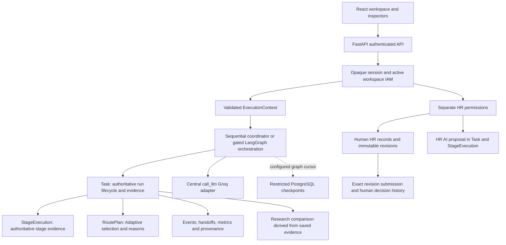

# Final project and architecture guide

This is the current Phase 10 implementation guide, verified against the local
checkout on 7 October 2026. Historical phase documents retain their dated evidence;
this guide consolidates the resulting system. See the
[acceptance report](PHASE10_ACCEPTANCE_REPORT.md) for final results and
[release assessment](RELEASE_READINESS.md) for unverified deployment gates.

## Objective and engineering contribution

FMProject makes AI execution inspectable and persistent, compares different
orchestration topologies under controlled inputs, and supplies bounded HR proposals
within an authorized human workflow. Its contribution is integrated application
engineering and reproducible evidence, not a newly trained model or proven hiring
predictor. The system combines React/Vite, FastAPI, SQLAlchemy, Groq, Google OIDC,
PostgreSQL RLS, and an integrated optional LangGraph checkpoint runtime.

## Architecture and execution authority

The diagram below consolidates the earlier README's Fixed-only flow. No second
business evidence store or HR approval engine is introduced.

The default sequential runtime remains active. LangGraph graphs and their adapter
are installed, tested and executable when explicitly configured. They delegate to
the shared stage/evidence functions, preserve API/event contracts and do not
replace Task or StageExecution. The diagram denotes responsibility, not the order
of first persistence: a queued Task exists before provider work begins.
The old `agents/orchestrator.py` prototype is inactive.

## Execution modes and specialist contracts

| Mode | Path | Evidence and semantics |
| --- | --- | --- |
| Single | Direct | One neutral direct-answer stage; no specialist handoff or routing request. |
| Fixed | Research → Data → Analysis → Summarizer → Report | Five selected specialists with sequential real-output handoffs. The coordinator makes no model call. |
| Adaptive | Validated rules-v1 path | Capability/input rules select only needed specialists for the stated category; saved selected/skipped IDs, reasons and validation. |
| Individual specialist | One selected system specialist | Legacy utility, distinct from the neutral Single comparison baseline. |
| Custom agent | One saved text definition/revision | Bounded model/token/timeout settings; excluded from the three-mode benchmark treatment. |
| HR assistance | One specialized HR contract | Exact saved sources and validated structured proposal output; separate HR authorization. |

ExecutionContext retains the original directive, bounded uploads/benchmark
aggregates and successful outputs with producer identities. Fixed prefers the
immediate predecessor artifact; Adaptive accepts only supported alternatives
and never fabricates a skipped artifact. Summarization needs an actual source.
Research means model reasoning on supplied material; Web Search is unavailable.
Adaptive uses deterministic rules, not learning, an LLM planner, or dynamic
replanning. Provider sampling uses SDK defaults; no controlled seed is promised.

## Persistence, migrations and recovery

Operational schema remains **13**. Task snapshots and normalized relational
projections persist simulations, stages, messages, activities, events, metrics,
upload links, identities/sessions, workspaces/memberships, separate HR assignments,
custom-agent definitions/revisions, hiring records/revisions and review history.
Dataset registry and system roster are shared metadata. Research metadata and
append-only human rubric assessments live in existing Task evidence, not new
experiment tables. Initialization is repeatable; migrations are additive except
reviewed SQLite membership-constraint rebuilding and historical V1 projection.
V1 archives and independent backup remain intact across later upgrades.

Checkpoint thread identity derives internally from workspace/task; callers cannot
supply thread IDs or read arbitrary checkpoints. A dedicated restricted saver
connection binds a transaction-local thread context, enforces RLS, validates role
privileges, uses a data-only serializer and serializes same-task workers with an
advisory lock. Its migration owner is separate from the runtime login.

Restart marks interrupted queued/running tasks and active stages failed. It does
not automatically resume or repeat a provider call. With the graph runtime
configured, authenticated `POST /api/v1/tasks/{id}/resume` validates eligibility,
checkpoint identity/context/route and committed evidence. Evidence ahead of a
checkpoint is reused; checkpoint success ahead of evidence fails closed. Completed
stages are not recreated or called again; handoff/event repair is deduplicated.
A crash after provider response but before evidence commit can still repeat an
external request on explicit resume. Exactly-once provider side effects are not
promised. One server worker is required until startup recovery is coordinated.

## Authentication, tenancy and RLS

Google OIDC uses state, nonce and PKCE, signature/audience/issuer verification,
verified-email claims and disabled-account denial. Provider tokens are transient.
The browser receives an opaque HttpOnly session token; the database stores its
one-way digest and revocation/expiry. Backend trusted origins protect browser
mutations and WebSocket admission; expiry/revocation is rechecked for live delivery.

Personal Workspaces authorize only their owner. Organizations require an active
workspace/user/membership; IAM roles are Owner/Admin/Member. Owners manage Admin
assignments and eligible permanent deletion; Admins manage member/HR-role assignments
and custom agents; Members execute/read permitted simulations and custom agents.
Human role assignments are separate. UI visibility never replaces backend checks.

PostgreSQL initialization installs ENABLE and FORCE RLS on all **22 tenant-owned
application tables**, with no deferred tenant-table activation. Transactions bind
trusted user/workspace context and clear it on commit/rollback. Missing or foreign
context denies tenant rows. Three checkpoint data tables have a separate thread
policy; checkpoint migration metadata is inaccessible to the runtime login.

Identity/session and system-global tables are not tenant business tables and are
accessed by the trusted service. RLS assumes the service authenticates and chooses
correct context. A compromised database credential or arbitrary trusted-service SQL
could set tenant GUCs; these are not cryptographic identity assertions. Protect
credentials, do not expose raw SQL, and independently verify deployment privileges.
SQLite relies on application authorization; it does not provide PostgreSQL RLS.

## HR authoring, AI assistance and human decisions

Recruiters manage requirements, organization knowledge and human JD drafts.
Requirements have bounded content/lifecycle fields. JD sources explicitly pin
requirement and optional knowledge IDs/revisions. Optimistic `expectedRevision`
protects editing; historical revisions retain authenticated editors and timestamps.
Source usage navigation includes immutable older JD revisions even when their head
points elsewhere. Archived/historical records do not gain current editing authority.

The specialized `hr_requirement_analysis`, `hr_jd_draft` and `hr_draft_validation`
contracts pass bounded exact sources to the central adapter. Stored Task/stage
evidence includes source fingerprints, versions, model, context, prompt/schema,
usage when available, validated structured output, timing and errors. Authorization
is checked before source reading, before provider work, and before accepting output.
Revocation discards the proposal and retains honest failure evidence. Generic
simulation endpoints exclude HR runs; organization IAM alone cannot read them.
AI has no role assignment, authoring, approval, publication or hiring authority.

Recruiters submit the current draft revision. Reviewers recommend or request
changes; Approvers review and explicitly approve/reject eligible submissions.
Transitions carry authenticated actor, notes, version and timestamp in immutable
history. Concurrent/stale decisions fail; a new JD revision requires a new
submission. Earlier approval remains attached to its exact revision. Optional AI
evidence association links a matching original run, not adoption or approval.
Combined human roles are allowed; the application records who actually acted and
does not enforce independent reviewers for every organization. Publication is absent.

## Research methodology and measured evidence

Seven synthetic version-1 cases cover direct answer, synthesis, data reasoning,
multistep analysis, summary, report and mixed capabilities. Definitions retain
directives, source, rationale, supported modes and deterministic checks. Admission
prepares routes before atomic persistence, supports 1–5 repetitions and at most
45 runs, and rotates mode order between repetitions. Background execution is
sequential. Compare each case and mode on matching input/source fingerprints.

Each Task retains exact benchmark/configuration snapshots, checksums, expected run
IDs, trial index, runtime/provider/model/token settings, package versions,
implementation/fixture fingerprints and parent rerun link. Phase 10 additionally
recomputes input provenance from benchmark sources and includes research admission,
provenance and evaluation code in the implementation digest. Reruns reject changed
configuration/benchmark or incomplete/inconsistent evidence and create fresh IDs;
original records remain unchanged. Reproduction means configuration reproduction,
not guaranteed identical provider text.

| Measurement | Interpretation and limits |
| --- | --- |
| Task elapsed/stage duration | Observed execution/persistence time; queue wait excluded; retry durations may accumulate. Interrupted timing can include downtime before recovery. |
| Agent calls / stage starts | Recorded stage-start attempts; not confirmed provider requests or SDK retries. |
| Handoffs | Saved inter-agent messages, not delivery acknowledgements. |
| Selected/skipped routes | Deterministic plan and route consistency; stage avoidance alone does not prove unnecessary reasoning. |
| Tokens | Returned input/output/total usage with measured-stage coverage; unknown/partial attempts do not become zero or complete totals. |
| Success/failure/timeouts | Terminal evidence with explicit errors/unstarted stages; only retained explicit timeout causes can be classified. |
| Monetary cost / SDK retries | Unknown; no estimated cost or fabricated provider telemetry. |
| Deterministic quality | Equal-weight surface-rule pass fraction; not semantic correctness or ground truth. |
| Human rubric | Seven 1–5 dimensions with rationale, actor/time/output hash and append-only history; descriptive, subjective and separate from deterministic scores. |
| Model-assisted judge | Explicit gated non-authoritative assessment; none used for final fixture evidence. |

Reported cells retain sample counts, mean, median, range and sample standard
deviation when available. Trials are small repeated observations, not evidence
of population inference. No significance test, global ranking or composite
quality/efficiency score is added. Phase 9's 42 trials remain historical fixture
evidence. Phase 10 exports another 42 trials for the corrected implementation.
Controlled fixture outputs deliberately satisfy their surface rules; 11 input
and 7 output tokens per mock completion are test values. Fixture latency excludes
real provider/network work. These results validate orchestration, measurement and
persistence only. Live model quality/latency/usage comparisons and independent
human assessment remain unverified.

## Frontend, data handling and deployment

The UI offers simulation creation/inspection/history, event/log/message views,
recycle/restore, custom agents, organization IAM/HR management, integrated hiring,
AI evidence, human review and Research Lab/report export. Workspace-scoped subtrees,
cancelled reads and generation checks prevent old responses from repopulating new
workspaces. Native dialogs contain focus and return it on cancellation. Final
browser evidence covers loading, explicit errors/retry, disabled authority,
keyboard confirmation/cancellation and a narrow viewport. It is sampled journey
acceptance, not an exhaustive assistive-technology certification.

Raw domain datasets are privately provisioned separately from SQLite/PostgreSQL;
only bounded safe aggregates enter benchmark prompts. Uploads and HR source text
are untrusted data and not automatically anonymized. AI instructions grant no
arbitrary tools or access. React renders output as text; CSV exports escape formulas.
Signing out revokes the session but does not erase evidence. Retention/account
erasure require an operator policy; automatic deletion is unavailable.

The target deployment is Vercel frontend → Railway FastAPI → durable PostgreSQL,
with server-side Google/Groq configuration and optional separate checkpoint schema.
Current proxy/session and graph activation gaps are explicit in
[RELEASE_READINESS.md](RELEASE_READINESS.md). A production build is compilation proof,
not deployed acceptance. No deployment or configuration change is authorized here.
Local setup and serial test commands are in the [README](../README.md).
The [demo guide](FINAL_DEMO_GUIDE.md) supplies an offline fixture path and a concise
presentation flow without fabricating academic results.
