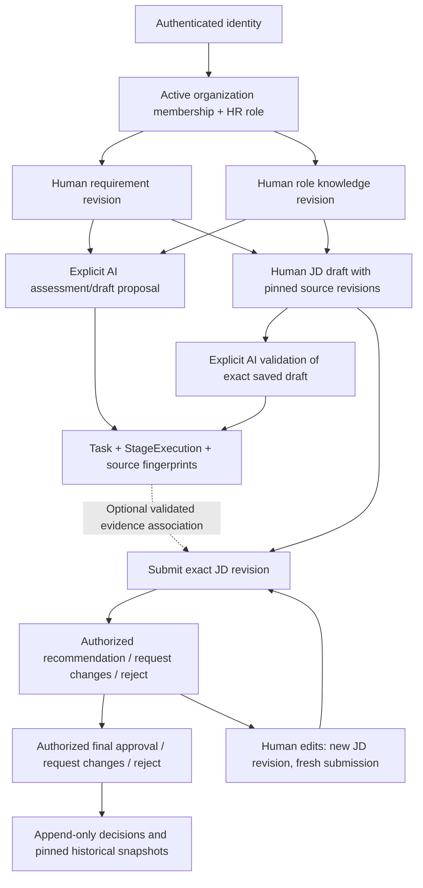

# HR Hiring storage and data flow — 2026-10-09

## Conclusive answer for the presentation

**Yes, HR Hiring storage was created. It consists of dedicated HR tables in the same application database used by authentication, organizations and simulations.** Locally it uses the configured SQLite file; the production declaration uses Railway PostgreSQL through `DATABASE_URL`. It is not a separate employee dataset file, PostgreSQL instance, or applicant-tracking system. Current code is schema 14; two existing local default SQLite files still have schema-13 metadata and were not modified here.

Option **C — dedicated HR tables in the existing tenant-aware PostgreSQL database** is sufficient for the current academic project. It preserves transactions, shared auth/IAM, organization boundaries, pinned source versions and real human decisions while avoiding another deployment/backup/credential system. No new HR instance or schema was added. Actual current production binding/role/catalog was not inspected; source declarations and historical acceptance are not a fresh production verification.

## Storage map, APIs and screens

All APIs below start at `/api/v1`. HR entities are organization-workspace owned; creator IDs attribute authorship rather than restrict visibility solely to the author. See [DATABASE_ARCHITECTURE_AUDIT.md](DATABASE_ARCHITECTURE_AUDIT.md) for all columns/FKs and physical connection details.

| Entity | Tables / relationships | API and frontend |
|---|---|---|
| Identity/session | `users`, `auth_sessions`; personal workspace owner / organization creator references users | `/auth/me`, `/auth/logout`, Google auth; `hooks/useAuth.js`, Login/sidebar profile. No Google password/provider tokens persisted. |
| Organization/workspace | `workspaces(kind=organization)`; no separate organizations table | `/workspaces`, `/workspaces/organizations`; Organizations page and WorkspaceProvider. |
| Membership/IAM | `organization_memberships(workspace_id,user_id)` → workspace/users; owner/admin/member | `/workspaces/organizations/{id}/members` and role/removal operations; Organizations member UI. |
| HR human responsibilities | `organization_human_role_assignments(workspace_id,user_id,human_role)` → workspace/user | Organization `/human-roles` and member role assignment/deactivation APIs; Organizations HR responsibility controls. |
| Requirement | `hr_requirements` current head + `hr_requirements_revisions` immutable payload; tenant-composite head/history FK | GET/POST `/hiring/requirements`, GET/PUT `/{id}`, GET `/{id}/revisions`; Hiring workflow/Records. |
| Role knowledge | `hr_role_knowledge` head + `hr_role_knowledge_revisions`; organization-specific competencies/terminology/criteria | `/hiring/role-knowledge` same CRUD/history pattern; Hiring workflow/Records. |
| Job description | `hr_job_descriptions` head + `hr_job_descriptions_revisions`; mandatory requirement ID/revision/workspace, optional knowledge pair, composite FKs to exact source revisions | `/hiring/job-descriptions` same CRUD/history; Hiring draft editor and historical source inspection. |
| Source usage | Derived traversal of JD revision FKs; no duplicate usage table | `/{requirements,role-knowledge}/{id}/revisions/{n}/job-descriptions`; Hiring “used by”/source history. |
| AI proposals/assessment | Existing `simulations.payload.hrExecution` Task evidence + `tasks`, `agent_executions`, `run_events`, shared execution projections | GET `/hiring/agents`, POST/GET `/hiring/agents/runs`, GET `/{taskId}`; HRAssistance panel/run inspector. No separate mutable AI-result store. |
| Review submission | `hr_review_submissions` → exact tenant JD revision; unique one per JD/revision/workspace; associated AI run IDs in JSON | POST/GET `/hiring/reviews`, GET `/{id}`, `/reviews/capabilities`; HRReviews/workflow status. |
| Human decision/history | `hr_review_events` → tenant submission; unique monotonic version, actor, action, from/to status, notes/time | POST `/hiring/reviews/{id}/review`, `/approval`, GET `/{id}/history`; HRReviews history/snapshot/actions. |
| Export/evidence | Generic run export JSON/text/CSV; research JSON report; immutable HR snapshots/history served by read APIs | `/simulations/{id}/export`; existing inspector/export and HR source/review screens. There is **no dedicated finalized-JD PDF/package export/publication API**. |

Source functions: `storage/hiring.py:save_hiring/get_hiring/linked_job_descriptions/bind_hr_sources`, `storage/hr_reviews.py:submit_review/decide_review/_review_record`, `api/routes/hiring.py:register/scope`, `api/routes/hr_agents.py:admit/run_hr`, `models/schemas.py` HR inputs, `security/hr_roles.py:ROLE_PERMISSIONS`; frontend `pages/Hiring.jsx`, `components/hiring/{HRWorkflow,HRAssistance,HRReviews}.jsx`, `utils/hrWorkflow.js`, `services/apiClient.js`.

## Human authority and validation

An active Google-authenticated local identity needs active membership in an active organization plus the required active HR human role. Personal Workspaces have no HR Hiring workflow. IAM Owner/Admin can manage responsibilities but **does not automatically receive HR create/read/approve permission**. Combined HR roles are permitted; distinct people for author/reviewer/approver are not currently mandatory.

| Role | Read HR | Create/edit requirements and knowledge | Create/edit/submit JD | Recommend | Request changes | Reject | Final approve |
|---|---|---|---|---|---|---|---|
| Recruiter | Yes | Yes | Yes | No | No | No | No |
| Reviewer | Yes | No | No | Yes | Yes | No | No |
| Approver | Yes | No | No | Yes | Only if also Reviewer | Yes | Yes |
| IAM Owner/Admin without HR roles | No HR-domain grant | No | No | No | No | No | No |

Final-stage reject/request-changes requires JD_APPROVE plus the specific action permission. Viewer/recruiter/reviewer permissions cannot be promoted by client-provided actor/role fields. Each operation rechecks active identity/membership/roles in its tenant transaction; HR PG policies independently require these grants.

HR schema inputs forbid extra fields and trim strings. Titles are strict 1–200 characters; item lists have ≤80 strict 1–4,000-character items; bounded experience/qualifications/department/location; requirement purpose required; openings strict integer 1–10,000; JD summary required ≤8,000. Reference IDs ≤80 and revisions strict positive integers. Client cannot choose creator/updater/approver IDs. Updates require `expectedRevision`; a stale revision returns 409 and leaves history intact. Review input forbids actor/status fields; decisions require strict positive `expectedVersion`, allowed decision and nonblank ≤4,000-character notes. Invalid bodies are 422; anonymous/revoked/expired sessions 401; inaccessible workspace/record/source 404; missing HR capability or accessible personal HR scope 403; stale/invalid transitions 409. Unexpected persistence failures are not disguised as approval/rejection.

## End-to-end flow

1. **Scope enters:** WorkspaceProvider discovers server-authorized memberships and selects an available organization. Saved browser selection is convenience; server rechecks session/workspace/IAM/HR authority. Changed shared-browser account invalidates the previous tab's asserted identity and resets provider/page state. Roles are never trusted from localStorage.
2. **Requirement enters:** Recruiter supplies organizational purpose, responsibilities, skills, openings and constraints. The validated head saves workspace/creator/revision/status; content saves in revision 1 JSON. Editing atomically advances head and inserts a new immutable revision. Requirement lifecycle accepts draft/active/closed/archived. Archived heads are read-only.
3. **Knowledge enters:** Recruiter writes that organization's role competencies/terminology/evaluation criteria. These are curated records, not the HR employee JSON benchmark. Knowledge is active/archived and versioned identically.
4. **Draft transforms input:** Recruiter deliberately writes a JD and selects required requirement revision plus optional knowledge revision. Repository resolves exact source records in the same tenant; relational composite FKs prevent foreign/missing revisions. Creating against currently archived/closed sources is refused. Source edits do not rewrite existing JD snapshots; the UI shows newer source revisions/historical use. Existing JD edits keep explicit chosen versions. JD content lifecycle is draft/archived; review status is separate.
5. **Optional AI transforms sources:** Three specialized contracts exist: `hr_requirement_analysis`, `hr_jd_draft`, `hr_draft_validation`. Assessment/draft requires JD_DRAFT_EDIT; validation requires JD_REVIEW and an exact saved JD/source match. Admission stores Task evidence containing requested references, SHA-256 content fingerprints, serialized ExecutionContext, contract version, system prompt/schema, provider/model and `proposalOnly=true`. Source size is bounded at 18,000 characters. The central `agents/llm_client.py:call_llm` is the only provider adapter; no shell/tools/browsing or database write authority is given to the model.
6. **AI saves honest evidence:** Worker claims once, reauthorizes before source access/invocation, records running stage, invokes bounded timeout (default 90s), validates strict JSON/types and cited source fields, reauthorizes before accepting output, then persists result/event/model/usage. It never edits the requirement/JD or creates a human decision. Failure/timeout/revocation retains a failed Task/stage with safe error and no fabricated success. An AI proposal must be deliberately incorporated by a human edit; that new revision is attributed to the human. No automatic one-click adoption/publication is implemented.
7. **Submission freezes the reviewed page:** Recruiter submits the current editable JD revision, optionally associating ≤10 unique same-tenant completed HR run IDs. Repository checks actual run/source compatibility; validation runs must reference the exact draft revision. Head/source edits, foreign/failed/deleted/mismatched evidence cannot be silently attached. Submission and first `submit` event are saved together; unique tenant JD revision permits only one submission for that revision.
8. **Humans decide:** Pending review can become reviewed (UI: Awaiting approval), changes_requested or rejected under permissions. A reviewed submission can become approved, changes_requested or rejected under final-stage permissions. Status comes from append-only events; approval cannot skip recommendation. PG advisory locks/triggers and SQLite BEGIN IMMEDIATE serialize document edits/decisions; expectedVersion rejects conflicting/stale decisions.
9. **History survives change:** Approved/rejected/changes_requested are terminal for that submission. Human revision creates a new JD version and fresh submission. Older request becomes derived stale when the JD head advances or archives; recorded decisions remain unchanged. An approval binds the old revision only. Pinning preserves original requirement/knowledge text even if source heads later change. Actor, timestamp, rationale and every prior decision remain inspectable.
10. **Frontend presents/fails safely:** Hiring combines workflow summary, record editor/revisions/“used by,” AI assistance and review/history panels with live capability controls. Workspace changes remount the page; read cancellation/generation guards discard obsolete responses; stale saves require reload. Missing data is empty/unavailable, never fabricated approvals. Actual provider integrations and current production authority are not proven by the safe local fixture tests.

## Retention and missing scope

HR heads/archive, immutable revisions and review tables have no permanent-delete endpoint; FK RESTRICT and SQLite triggers/PG insert-only policies preserve source/decision history. Membership/role removal withdraws future access while retained HR actor references remain. Role assignments/memberships record current/latest fields, not a complete append-only IAM assignment-event journal.

AI Task evidence shares current Recycle Bin lifecycle: terminal runs may be soft-deleted/restored and explicitly owner-purged. Immutable JD/source/review text survives purge, but `hr_review_submissions.ai_run_ids` is JSON without a relational retention guard. A later purge can remove the optional AI output behind a historical ID. Permanent inspectable AI evidence therefore needs a defined retention rule/guard or controlled export in a future scoped change. Do not claim the current review association prevents purge.

| Scope | Implemented or missing? | Database implication |
|---|---|---|
| Job-description workflow | Implemented: requirements, knowledge, revisioned draft, proposals, review/recommendation/approval/history | Existing eight HR tables plus existing IAM/Task tables suffice. |
| Final approved-JD distribution/export package | Human approval exists; dedicated PDF/package/publication flow absent | Add an explicit authorized export feature only if required; no second database needed. |
| Recruitment pipeline, vacancies posted publicly | Not implemented by this JD workflow | Needs separate scoped product/data lifecycle design. |
| Applicants/candidates/resumes | No candidate/resume entities or applicant intake tables | Do not reuse benchmark employee files or unrestricted uploads as an ATS/PII store. |
| Interviews/ratings/offers/applicant tracking | No interview, candidate assessment, offer or ATS state machine | Future features need dedicated tenant-aware entities and retention/privacy controls, not silent expansion here. |
| Sensitive candidate personal data | No dedicated access/consent/retention/encryption/document-storage design implemented | Requires explicit scope approval and design before collection; no candidate data was added. |

Existing tables support the requested academic JD/human-review demonstration. Remaining meaningful improvements are inspectable AI-evidence retention, clearer safe demonstration guidance, and verified production backup/role/catalog/auth acceptance. Another HR database would add cost/deployment/recovery complexity without completing these missing workflows.

## Local verification and limits

The focused storage/research/HR/security selection passed **216 tests**, including source-revision integrity, permissions, proposal contracts, append-only human decisions, stale/conflicting transitions, workflow integration and run lifecycle. All AI provider calls in these tests were deterministic mocks. **26 optional restricted PostgreSQL tests were skipped**; no credentials/schema were provisioned and no current live FORCE RLS result is claimed. Earlier Phase 5–10 reports contain historical SQLite/browser/restricted-PG evidence; this audit checked current code against those descriptions and corrected outdated purge assumptions. See [OAUTH_RELIABILITY_AUDIT.md](OAUTH_RELIABILITY_AUDIT.md) for current authentication/browser validation.
