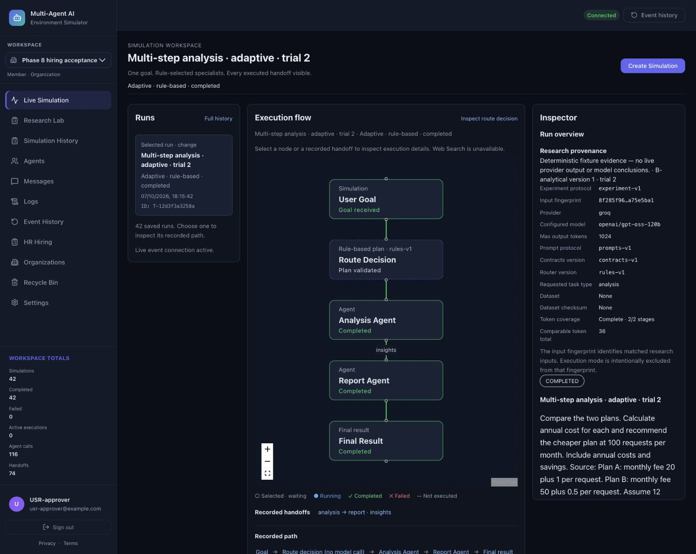
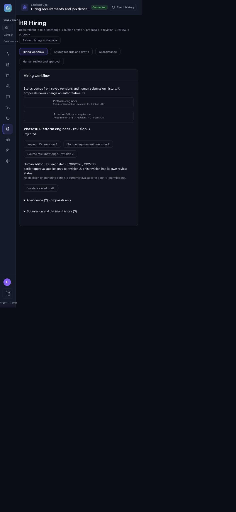

# Phase 10 — final consolidated local acceptance

**PASS — locally complete; production gates remain.**

Accepted on 7 October 2026 (Asia/Kolkata), including the continuation after the
usage-limit interruption. This completes Phase 10. It does not authorize another
phase, a push, deployment, production migration or live-provider traffic.

## Verified starting state and final scope

Starting HEAD: `f9b60972e6dc6ab8809f1e378cd4cbac6d56ed06` on `main`.
The preceding Phase 9 commits `97a2c68` and `c2cd390` matched the requested baseline.
Initial status was exactly `?? AGENTS.md`; log and whitespace checks were inspected
before editing. AGENTS.md was never edited, staged, committed, renamed or deleted.
Phase 4–9 acceptance reports were reconciled with actual current code and tests.
Their dated counts were not substituted for fresh verification.

The audit covered architecture, API/worker authorization, tenant/RLS inventory,
identity/session/origin handling, persistence/migrations, graph/checkpoint recovery,
HR source binding, human decision history, research provenance/metrics, frontend
workspace state and real browser journeys. No working architecture was redesigned.
Schema stays **13**. Single, Fixed and Adaptive retain their existing semantics.
Task, StageExecution and RoutePlan remain authoritative; graph checkpoints remain
orchestration persistence. Human records and exact submitted revisions remain
independent of AI proposals and IAM ownership.

Local hardening commit: `603510ae843e59982a1516d5b251dacd6e3b9627`.
The final HEAD is the subsequent documentation/acceptance commit containing this
report; its exact hash is supplied by the completion response and `git rev-parse HEAD`.
A commit cannot embed its own content hash. Neither commit is pushed; all Phase 1–9
history is preserved. The exhaustive file manifest is
[acceptance/phase10-changed-files.txt](acceptance/phase10-changed-files.txt).

## Confirmed defects and corrections

| Severity | Reproduced finding | Minimum correction and evidence |
| --- | --- | --- |
| P2 | Completed V1 migrations retain archive tables, but upgrades from operational versions 2/9/12 incorrectly failed as interrupted V1 migration. Three failing regression cases reproduced it. | Restrict the interruption guard to versions 0/1. Keep archive/backup/evidence intact, retain interruption denial and schema 13; four new migration regressions pass. |
| P2 | Research comparison accepted absent provenance, identically corrupted input fingerprints, and a corrupted directive hash. Three failing cases reproduced it. | Recompute benchmark input provenance and reject missing/inconsistent source evidence. No mode or score semantics changed. |
| P2 | Research implementation digest omitted admission, provenance and evaluation modules; three controlled drift tests failed. | Include experiment modules and admission routes in the retained implementation digest; rerun drift protection now covers them. Original reports/configurations are not rewritten. |
| P1 | Simulation state could expose the previous workspace during render, accept an obsolete A→B→A response/error, or inject a late foreign-workspace creation acknowledgement. Four behavioral tests failed. | Add workspace generations, immediate scope masking and acknowledgement denial, with four passing real-hook deferred-read regressions. Provider/runtime behavior is unchanged. |
| P2 | Four old authentication-denial tests started the default application repository through TestClient lifespan. A protected-copy probe showed SQLite header writes despite passing request assertions. | Add an explicit opt-in startup fixture to those four cases, with a default-file fingerprint assertion. The targeted repeat passes all four and leaves bytes/logical contents unchanged. This is test infrastructure only. |
| Documentation | README omitted Research Lab and contradicted installed LangGraph; backend README described schema 11/14 RLS tables; legal text omitted saved HR/provider processing and called HR functionality future work. | Consolidate actual architecture/features/setup, current schema/22-table RLS, limitations, proposal/revision semantics and data handling. Mark Phase 3 design text as historical. |

Initial failing reproductions remain in `phase10-defect-reproduction.txt` and
`phase10-startup-isolation-reproduction.txt`; assertions were not weakened to pass.
Targeted corrections passed before integration acceptance. Frontend tests run
serially to respect the 8 GB development machine. One redundant generation cleanup
increment was removed after lint identified a new warning; all four race tests and
the frontend suite were rerun, leaving only the two existing Fast Refresh warnings.

## Exact final validation

| Check | Passed | Failed | Skipped | Evidence |
| --- | ---: | ---: | ---: | --- |
| Complete established backend suite, real approved local PostgreSQL/checkpoints enabled | **807** | **0** | **0** | [backend log](acceptance/phase10-backend-validation.txt) |
| Real local PostgreSQL/checkpoint/rollback SQL cases within that full suite | **84** | **0** | **0** | [validation summary and module inventory](acceptance/phase10-validation-summary.json) |
| Backend cases affected by the later test-only startup-isolation correction | **4** | **0** | **0** | [targeted/default-file protection log](acceptance/phase10-startup-isolation-validation.txt) |
| Complete final frontend suite | **139** | **0** | **0** | [frontend log](acceptance/phase10-frontend-validation.txt) |
| Final manual browser acceptance checkpoints | **42** | **0 unresolved** | **0** | [browser checklist](acceptance/phase10-browser-checklist.md) |
| Separate exported success-fixture trials (not automated test count) | **42** | **0** | **0** | [retained fixture report](acceptance/phase10-fixture-report.json) |

The 807-pass backend run completed in 197.93 seconds and remains valid for unchanged
application/backend source. The continuation changed only four test fixture bindings
and added their isolation/fingerprint guard; these four cases were rerun separately.
The current collection still contains exactly 807 cases. The four targeted passes
are overlaps, not four additional tests. No expensive full backend rerun was needed.
The final source/test fingerprints, installed Python/Node/package inventory,
22 active application RLS tables and zero deferred tables are retained in the
validation summary. Final frontend regression ran after its last source correction.

Other final checks:

- Frontend lint: exit 0, zero errors, two existing Fast Refresh warnings.
- Frontend production build: exit 0; existing bundle-size advisory remains.
- Python compileall over application/tests/scripts: exit 0.
- pip check: no broken requirements; harmless cache-permission notice remains.
- Working/staged Git whitespace checks: exit 0.
- Two existing backend dependency deprecations remain; no failures/skips hidden.

Saved CLI logs are normalized for trailing whitespace only; failures and counts
remain intact. Logs are `phase10-lint.txt`, `phase10-build.txt`, `phase10-compile.txt`,
`phase10-dependencies.txt`, `phase10-whitespace.txt`, plus focused backend/frontend,
PostgreSQL and consolidated-persistence logs. Existing React Flow development
warnings were observed; they did not block saved execution inspection.

## PostgreSQL, migration, runtime and security result

The existing `fm-tenant-postgres` PostgreSQL 16.15 container was reused, bound only
to `127.0.0.1:55432`, database `fm_tenant_test`. The user explicitly approved fresh
restricted local acceptance credentials. Application and separate checkpoint logins
were NOSUPERUSER/NOBYPASSRLS/NOCREATEDB/NOCREATEROLE/NOINHERIT/NOREPLICATION,
expiring and bounded to four connections. Test schemas were random and disposable;
checkpoint acceptance used `phase10_checkpoints` and a separate NOLOGIN owner.
No production credentials or BYPASSRLS privilege were used.

The full suite verifies clean/repeated initialization and representative older
SQLite/PostgreSQL migrations, retained execution/custom/HR/review/research evidence,
all 22 tenant ENABLE/FORCE policies, missing/foreign context denial, pooled context
cleanup, active/revoked user/membership/roles, actor spoofing and concurrent/stale
human decisions. Checkpoint tests use real restricted Psycopg persistence/reconnect,
thread isolation, same-task exclusion, process death, startup interruption and
explicit all-mode recovery without repeating committed stages. Exactly-once
external model calls are not claimed. Production graph activation is unchanged.

The consolidated persistence test combines older approval/new JD revision,
custom-agent config, six research trials and recycle/restore across repeat
initialization on both engines. The security matrix and explicit trusted-service
GUC/SQLite/combined-role assumptions are in
[RELEASE_READINESS.md](RELEASE_READINESS.md). Local security acceptance passes;
this is not an external penetration-test or production security certification.

## Browser and research evidence

Actual authenticated APIs and disposable storage were exercised through the
in-app browser: simulation Single/Fixed/Adaptive, exact inspector/handoffs/events,
failure/nonexecution, history/metrics, confirmation keyboard cancellation,
recycle/restore, custom-agent authoring/run/revision history, organization role
presentation, Research Lab admission/comparison/export/rubric/rerun, human JD
sources, all three HR agents, and distinct Recruiter/Reviewer/Approver sessions.
The journey requests changes on revision 1, explicitly revises/resubmits revision 2,
recommends/approves it, then submits/reviews/rejects revision 3 while preserving the
old approval. Personal/IAM-only HR denial and delayed source-read discard pass.

Transient fetch failures were explicitly surfaced in Agents, Hiring and Research
Lab and recovered with refresh/reload; the transport cause was not established.
There are zero unresolved final checkpoints, not a claim that every attempted
request succeeded. Report preview/API content was verified; a saved browser file
download is not claimed. Requested 390px width was clamped to 650px by the in-app
browser; actual 650px layout was verified and the override reset. This is sampled
keyboard/responsive acceptance, not exhaustive mobile/assistive-technology certification.
Saved screenshots were visually inspected: one captured the Adaptive inspector
instead of the intended approval view and was renamed/captioned accordingly.
The approval chain is verified in the browser ledger; the narrow screenshot shows
revision 3 with the explicit earlier-approval boundary.

The separate final export contains seven cases × three modes × two repetitions,
42 complete persisted success-fixture trials with consistent retained configuration
and input evidence. It uses the corrected implementation digest and preserves the
original Phase 9 file. Controlled completions report 11 input/7 output tokens;
local timings contain no live provider/network component. Single has 14 starts,
Fixed 70 and Adaptive 32; handoffs are 0/56/18. These are topology/machinery counts,
not confirmed external request or quality/efficiency advantages. Cost is unknown.
Surface checks deliberately pass known fixture answers. No independent human
assessment or model judge is claimed; the extra UI rubric entry explicitly says
fixture UI acceptance. No live quality, speed, token/cost superiority, significance
or global winner has been established. No live Google/Groq request was made.

## Documentation delivered

- Root/backend/frontend READMEs describe the actual system and local setup.
- [FINAL_PROJECT_GUIDE.md](FINAL_PROJECT_GUIDE.md): objective, consolidated architecture diagram, execution/graph/persistence/auth/tenancy/custom/HR/HITL/research contracts and limitations.
- [RELEASE_READINESS.md](RELEASE_READINESS.md): independent security/migration matrix, assumptions and exact production gates.
- [FINAL_DEMO_GUIDE.md](FINAL_DEMO_GUIDE.md): disposable offline fixture, academic flow, reusable technical summary and precise viva answers.
- Phase 3 architecture has a historical-snapshot banner; Phase 4–9 acceptance records remain intact.
- This report, machine-readable validation/source inventory, logs, 42-trial export, browser checklist, screenshots and exhaustive changed-file manifest consolidate acceptance.

## Cleanup and remaining gates

Both temporary login roles are now NOLOGIN with NULL passwords. Test CONNECT/CREATE
and checkpoint privileges were revoked or removed with the isolated schema.
Independent verification reports zero sessions, owned test schemas, checkpoint owner
roles and role memberships. Private password/baseline/XML directory and both
controller scripts were removed. API/Vite/npm processes and listeners on 8019/5179
are gone. Forced SIGTERM bypassed fixture teardown; its exact disposable database
directory was manually removed and verified absent. Browser tab closed; viewport
reset. The pre-existing local PostgreSQL container was retained.

The original combined byte-fingerprint cleanup assertion failed and its comparison
baseline was removed prematurely. It is preserved in the cleanup log, not hidden.
A copy-only probe reproduced header-only root SQLite writes with identical logical
contents; the four default-store startup tests were corrected and revalidated.
Root schema is 13 with no business records; the historical backend database remains
schema 9 with existing evidence and a pre-task modification time. Integrity checks
pass. No data loss was observed, but a full original byte-for-byte file/checkpoint
preservation claim cannot be made from the removed baseline. No user database was
restored, deleted or migrated to conceal the assertion.

The final local Git tree is expected to contain only intentionally untracked
AGENTS.md after the documentation commit; completion verifies that state. No
credentials/private artifacts are staged. No push, history rewrite, deployment,
Railway/Vercel/OAuth production change, live-provider call or graph activation occurred.

Production remains gated on the known auth/workspace proxy mismatch, actual Google
OAuth/cookie/domain behavior, backed-up production migration/runtime-role/RLS checks,
WebSocket/reconnect/restart behavior, single-worker and checkpoint-role provisioning,
explicit graph activation, approved live Groq/HR verification, reproducible dependency
packaging and operations/retention/license decisions. Live repeated comparative
research additionally requires an approved design and independent quality assessment.
Local acceptance is complete with those explicit production/research limitations.
