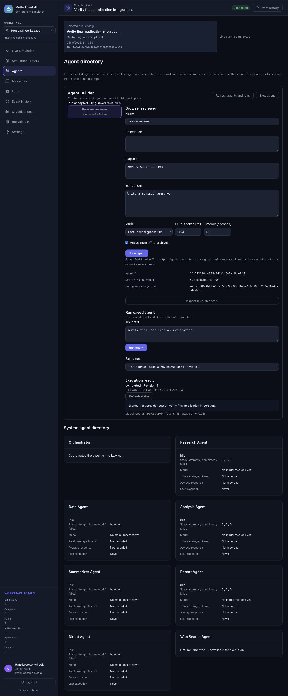

# Phase 4.9 — Executable Agent Builder

## Implemented scope

The Agents page now manages workspace-owned custom agents. Owners of Personal
Workspaces and organization owners/admins create, edit, archive and reactivate
agents. Active members can inspect definitions/revisions and run active agents.
HR human-role assignments grant no additional agent-management permissions.

This is a constrained text-input/text-output agent. Saved definitions contain a
server-generated stable `CA-` ID, tenant ownership, name, description, purpose,
instructions, model choice, bounded output tokens/timeout, and active status.
Only the existing Groq adapter is supported. `default` and `fast` resolve to the
server's `GROQ_MODEL` and `GROQ_FAST_MODEL`; the exact resolved model is persisted
in each revision. No provider key or endpoint can be configured through this API.

Input is nonblank text up to 10,000 characters. Name/purpose/instructions limits
are 80/1,000/8,000 characters; description is at most 1,000 characters. Output is
nonblank text up to 65,536 characters; provider output token budget is 64–1,024;
timeout is 1–120 seconds. Unknown configuration fields, provider/model selectors,
contracts and capabilities are rejected. JSON output contracts, files, uploads,
benchmark access, browsing, arbitrary URLs, plugins, shell/code execution and
custom Fixed/Adaptive topology are not supported.

## API and identity

All endpoints require the existing authenticated session and workspace access.
`X-Workspace-Id` selects a workspace; membership/ownership is resolved on the
server, and omission defaults to the user's Personal Workspace. An ID in a
header or body never grants access.

| Endpoint under `/api/v1` | Behavior |
| --- | --- |
| `GET /agent-builder/options` | Public supported model IDs and text contract options, after authorization |
| `GET /agent-builder` | Workspace definitions, including inactive ones |
| `POST /agent-builder` | Create a validated definition, revision 1 (201) |
| `GET /agent-builder/{id}` | Current definition |
| `PUT /agent-builder/{id}` | Full configuration update with `expectedRevision`; appends a revision |
| `GET /agent-builder/{id}/revisions` | Immutable saved configurations and actor/time metadata |
| `POST /agent-builder/{id}/runs` | `{text, expectedRevision}`; returns an authoritative queued Task (202) |
| `GET /tasks/{taskId}` | Existing workspace-scoped execution status, evidence, output/error |

Set `active: false` in a configuration update to archive; set it true in another
revision to reactivate. There is no definition-purge endpoint. Names are trimmed,
casefolded and unique within the workspace, including archived definitions.
Duplicate names and stale expected revisions return 409; invalid input returns
422; unauthorized requests return 401/403; unavailable tenants/IDs return 404.
Inactive agents and revision-integrity failures return 409 before admission.

`POST /agents` previously stored unauthenticated global metadata; it now requires
management authorization and returns 410 with guidance to use `/agent-builder`.
Historical display metadata remains non-executable and is preserved. The system
roster and its six executable IDs are unchanged.

## Execution and evidence

Run admission atomically rechecks active IAM and definition state and binds a
queued Task to its saved revision/hash. The background worker rechecks agent-run
permission, current active status, revision integrity and permitted model before
calling the provider. Edits after admission do not change the selected revision;
archiving or membership revocation before the call prevents invocation.
Revocation does not undo a provider request already in flight.

`CustomAgent.run` accepts the validated immutable `ExecutionContext`, puts
purpose/instructions/input in a JSON **user** message, and uses a fixed application
system prompt. User instructions never become system authority. Safety depends
on structural capability restrictions: the adapter receives no tools, secrets,
workspace data, file handles, command execution or network targets. A model may
still produce inaccurate or unsuitable text; prompt wording is not an IAM guard.

The existing `call_llm` adapter makes the actual configured Groq completion.
`asyncio.wait_for` bounds the request. Empty/oversized outputs fail explicitly;
SDK/provider errors are mapped to safe messages without recording SDK headers,
URLs or payloads. Actual model/token usage enters the request-local stage sink.
The existing `_run_stage` and Task lifecycle persist StageExecution, status,
output/error, timestamps, latency, events, activities and metrics. There is no
parallel execution-evidence store. `customAgentRevision` and
`customAgentConfigHash` identify the revision used; its immutable snapshot remains
in the revision table. Provider failure/timeout yields a failed Task, not success.

Custom Tasks have a distinct `custom` mode and one explicit stage. They never
enter the six-ID output contracts, specialist routes, Adaptive RoutePlan or
LangGraph GraphRunState/checkpoint runtime. The default graph activation flag is
unchanged. Custom runs cannot use durable graph resume. Process interruption is
handled by the existing startup recovery, which records failure; the user may
explicitly create another run. This implementation uses the existing in-process
background worker rather than adding a durable job queue.

Existing simulation history/export/status views can inspect custom Tasks. The
recycle bin retains custom execution evidence, denies permanent purge of
executed runs, and restores the same authoritative payload/stage evidence.

## Schema 11 and security

Initialization migrates schema 10 additively to 11 on SQLite/PostgreSQL. Existing
users, memberships, uploads and execution payloads are preserved; no user data is
assigned to custom agents and no tables are destructively rewritten.

- `custom_agents`: stable ID, non-null workspace FK, unique workspace/name key,
  current revision/active state, creation actor/time.
- `custom_agent_revisions`: composite agent/revision primary key, non-null
  workspace, composite FK to the same tenant's definition, validated JSON
  configuration, resolved model, SHA-256 fingerprint and revision actor/time.
- No custom-agent execution table: Task/StageExecution remain authoritative.

Repository operations recheck active user/workspace/membership and IAM inside
transactions using the existing locked workspace authorization primitive.
Optimistic compare-and-swap and unique constraints reject concurrent/stale edits.
SQLite revision UPDATE/DELETE triggers preserve immutable history, including V1
migration; application RBAC provides SQLite tenancy. PostgreSQL initialization
activates ENABLE/FORCE RLS on both new tables. Definition SELECT requires active
ownership/membership; definition writes require owner/admin authority. Revisions
permit authorized SELECT and manager INSERT with the authenticated revision actor;
there is no UPDATE/DELETE policy. The composite FK prevents tenant-parent mismatch.
The deployment database role must remain NOSUPERUSER/NOBYPASSRLS with no membership
in bypass roles, as required by existing initialization. Application credentials
and schema administration remain trusted infrastructure, not agent capabilities.

## Local acceptance

Acceptance uses disposable SQLite databases, isolated random PostgreSQL schemas
in the verified existing `fm_tenant_test` database on `127.0.0.1:55432`, and the
existing separate checkpoint fixture. No production URLs, Railway changes,
production graph activation, real provider requests or paid usage are involved.
Temporary acceptance credentials are approved by the user, restricted and
expiring; their private password file is removed and logins disabled afterward.

Automated coverage includes invalid/extra capabilities, duplicate names, revisions,
archive/reactivate, IAM roles, inactive/revoked membership, tenant-ID attacks,
SQLite/PostgreSQL migration and immutability, raw FORCE RLS enforcement, actual
provider-adapter traversal with only its SDK response mocked, timeouts/cancellation,
provider failures, output limits, usage/evidence and recycle-bin retention.
Frontend tests cover form limits, supported options, IAM affordances, authenticated
workspace API wiring, revision errors, uncertain acknowledgements and custom mode.

Browser acceptance uses `backend/tests/agent_builder_browser_fixture.py`, an
explicit test-only localhost server with a disposable database and mocked provider.
It is never imported by production code. Verified workflows: empty state; invalid
instructions; create; fast model selection; saved-revision output/usage; edit;
revision history; archive/disabled run; reactivate; sanitized provider failure;
workspace isolation; member read-only management controls with permitted execution;
and previously saved output after workspace switch.

Live Groq verification remains an external gate: use valid server credentials
and verify the allowed model IDs with an explicitly authorized provider request. The local test suites intentionally do not perform that call.
Production rollout and persistent LangGraph deployment gates remain separate;
see `PHASE4_LANGGRAPH_RUNTIME.md`. Phase 5 is outside this change.

## Final acceptance — 6 October 2026

- Backend: **574 passed, 0 failed, 0 skipped**, 2 dependency deprecation warnings,
  60.20 seconds. This includes all 526 previous tests and 48 new builder tests
  (43 SQLite/API/adapter tests and 5 live PostgreSQL tests).
- Frontend: **84 passed, 0 failed, 0 skipped**, 3.14 seconds; all 76 previous tests
  plus 8 builder tests. Oxlint exits successfully with 2 existing Fast Refresh
  warnings; Vite production build passes.
- `git diff --check` passes. No dependency installs or new paid services.
- Existing Single/Fixed/Adaptive, graph/checkpoint security and recycle-bin tests
  all pass in the consolidated backend suite. SQLite/PostgreSQL schema 10 migration
  preserves prior execution evidence. Unicode casefold expansion is supported in
  PostgreSQL name uniqueness keys.
- Browser workflows described above passed against real local APIs with only the
  provider mocked inside the explicit browser test fixture. Accepted custom runs
  join the application's selected-run view. All fixture servers and temporary
  browser data were removed; temporary PostgreSQL logins were disabled and their
  private password file/session manifest removed.
- Application graph runtime defaults remain disabled. Test credentials never used
  production URLs; no Railway changes, push, deployment or Phase 5 work occurred.
- The deterministic local test environment has no configured Groq key. A live
  provider acceptance call was deliberately not made; this does not prevent
  deterministic local implementation acceptance.

Backend implementation commit: `2f1bbd4`; frontend/browser fixture: `fa46283`;
Unicode storage correction: `5488ea6`. The subsequent documentation commit
contains this report and screenshot. `AGENTS.md` remains untracked and untouched.

**Phase 4.9 is locally complete. Phase 4 may proceed to its final consolidated
acceptance audit. Production/live-provider and persistent graph deployment gates
remain outstanding; this is not a deployment claim.**

