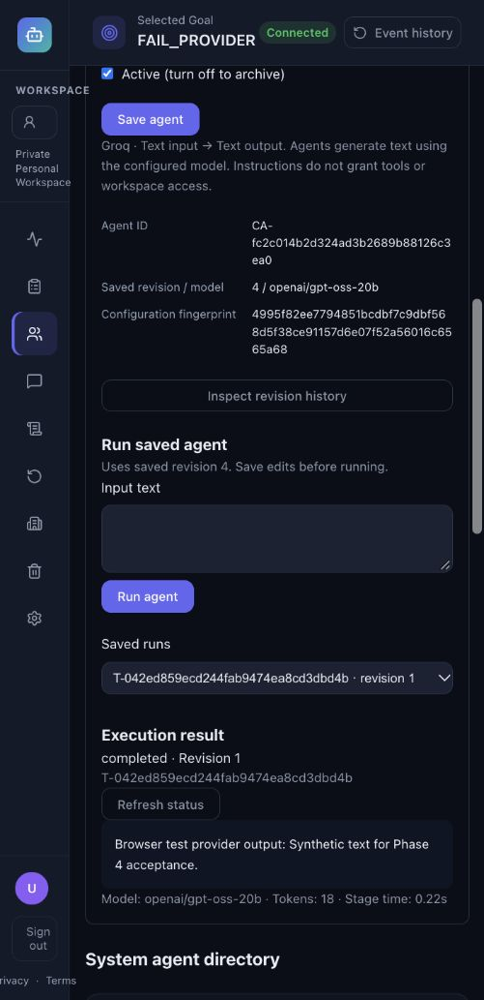

# Phase 4 Final Acceptance Report

**Audit date:** 6 October 2026 (Asia/Kolkata)
**Repository:** `/Users/shreetej/Downloads/FMProject`
**Recommendation:** **CONDITIONAL PASS — Phase 4 is locally complete after the corrections below. Production acceptance remains outstanding.**

## Executive summary

This audit independently inspected the current implementation and reran its tests; earlier acceptance reports were treated as historical evidence only. The starting HEAD was `b3b250aa4e505e90cd08ccf619b17921761bccec` on `main`, with only untracked `AGENTS.md`. The reported Phase 4.8/4.9 commits were present in its ancestry.

All Phase 4.1–4.9 deliverables have an implemented local execution/authorization path. The audit found and corrected two High browser-security defects, a Medium provider-diagnostic disclosure defect, and a Low test-dependency omission. It also reconciled outdated documentation. No unresolved Critical or High defect was found in the audited active local paths after those corrections.

Consolidated acceptance: **592 backend tests passed, 0 failed, 0 skipped**; **84 frontend tests passed, 0 failed, 0 skipped**. The backend run included all 51 real local PostgreSQL integration cases, rather than counting skipped gates as success. Python compilation, declared dependency compatibility, frontend lint/build and Git checks passed. Relevant browser workflows passed against disposable data and deterministic provider fixtures.

The graph runtime remains disabled by default. No real Google login or live Groq completion was attempted. Provider integration tests traverse the actual adapters with SDK responses mocked; browser provider responses are also mocked. No production credentials, push, Railway changes, deployment, or Phase 5 work occurred.

## Milestone audit results

| Milestone | Independent result | Implementation and verification evidence |
| --- | --- | --- |
| 4.1 Authentication | PASS locally after browser corrections | `api/routes/auth.py`: Google authorization-code flow, state/nonce/PKCE, signature/audience verification, verified identity, hashed opaque 12-hour sessions and revocation. `test_google_auth_api.py`, `test_auth_storage.py`, new browser-session regressions. Google exchange/verifier are mocked. |
| 4.2 Workspace tenancy | PASS | Personal ownership, organization membership, discovery and request workspace resolution in `security/workspaces.py`, `api/routes/workspaces.py`, `storage/database.py`. Workspace IDs and legacy owner IDs do not grant access. Multi-tenant API/upload/WebSocket tests exercise foreign IDs and inaccessible workspaces. |
| 4.3 IAM/RBAC | PASS | `security/rbac.py`: centralized owner/admin/member permissions and fail-closed unknown roles. Enforcement tests cover owner/admin/member differences, revoked membership and denied management operations. |
| 4.4 HR human roles | PASS | `security/hr_roles.py` and organization HR endpoints separate Recruiter/Reviewer/Approver responsibilities from IAM. Adversarial API/repository/RLS tests prevent HR-role privilege escalation and Personal Workspace HR semantics. Browser assignment retained the target's Member IAM role. |
| 4.5 PostgreSQL isolation | PASS on the local test database | All 14 tenant tables use ENABLE/FORCE RLS. Local restricted-login cases verify unscoped/foreign reads, rejected writes, cleared transaction settings, unsafe-role refusal and startup recovery. Production role/migration checks remain gates. |
| 4.6 Organization administration | PASS | Creation/join, role changes, active-member listings and soft removal use authenticated actor and transaction-time safeguards. Last-owner protection, member/admin limits, stale authority and HR-assignment deactivation have negative tests. |
| 4.7 LangGraph/checkpoints | PASS locally; activation gated | Single/Fixed/Adaptive graphs use the shared task worker and stage boundary. Real Psycopg saver reconnect, task binding, locks, crash/restart/resume, typed restoration, checkpoint failure and evidence reconciliation passed. Default activation was not changed. |
| 4.8 Recycle Bin | PASS | Tenant/IAM-scoped terminal-run soft deletion/restoration retains the full Task/evidence aggregate. Evidence-bearing and graph runs cannot be purged; the narrow never-executed legacy purge case is tested only in disposable fixtures. Browser cancellation, soft deletion, restoration and member denial passed. |
| 4.9 Agent Builder | PASS locally | Tenant definitions, immutable revisions, optimistic updates, name uniqueness, strict text/model/capability restrictions and pinned run configuration. Actual provider-adapter traversal with only the SDK response mocked; no live-provider claim. Browser create/run/edit/history/archive/reactivate/failure/member workflows passed. |

Milestone labels reflect the existing Phase 4 scope. This audit creates no additional numbered subphase.

## Confirmed security defects and corrections

### F-01 — High: live WebSockets retained revoked authority (resolved)

**Location:** `backend/app/main.py:websocket_endpoint` (now lines 83–129); `backend/app/websocket/manager.py:ConnectionManager.connect/broadcast/authorized` (lines 15–69).

Before correction, session and workspace authorization occurred only at handshake. The manager retained just the workspace ID and continued sending tenant evidence after a member was removed, the user logged out, the session expired, or the user/workspace became inactive. HTTP refusal did not revoke the already-open socket.

**Reproduction:** `backend/tests/test_browser_session_security.py:test_existing_socket_stops_receiving_after_authority_removed` establishes a valid organization connection, confirms one allowed delivery, removes authority in each of five ways, and broadcasts again. All five cases received another JSON payload before the fix instead of a disconnect.

**Correction:** retain an application authorization callback for production connections; recheck the original opaque session, active user and workspace membership before every delivery. The receive loop also rechecks idle connections on a 30-second interval. Failed authorization/storage checks stop delivery and close the socket without diagnostics; `finally` removes the connection. The five adversarial cases now pass. The idle interval is additionally confirmed by code inspection; these five tests specifically verify the outgoing-delivery boundary.

### F-02 — High: missing browser-origin protection (resolved)

**Location:** `backend/app/main.py` middleware registration and `websocket_endpoint`; new `backend/app/security/browser_origin.py:trusted_browser_request/BrowserOriginMiddleware` (lines 14–45). Existing cookie policy is in `api/routes/auth.py:_set_session_cookie`.

Production sessions use `Secure; HttpOnly; SameSite=None`. CORS response restrictions alone did not prevent simple cookie-bearing requests or cross-site WebSocket handshakes. An authenticated `POST /uploads?filename=attack.txt` with `text/plain` and an attacker Origin stored the upload; a cross-origin logout revoked the session; an attacker-origin socket connected successfully.

**Reproduction:** the upload cases (attacker domain, `null`, deceptive localhost suffix), logout case and two WebSocket Origin cases in `test_browser_session_security.py` all failed their denial assertions before correction.

**Correction:** validate exact configured `CORS_ORIGINS` for unsafe HTTP methods and socket handshakes, with an exact-origin Referer fallback. Reject null/untrusted/multiple origins and browser Fetch Metadata requests with no trusted source. HTTP refusal is 403; socket Origin refusal is 4403. Header-less non-browser clients retain the existing authenticated API contract; possessing a real opaque session is still mandatory. Valid frontend requests and CORS preflight remain functional. The regression file now contains 17 passing cases, including all authority-removal cases above. Browser API and live connections also passed with the fixture's explicitly trusted localhost origin.

This approach follows the browser-origin and ongoing-session controls described in the [OWASP WebSocket Security Cheat Sheet](https://cheatsheetseries.owasp.org/cheatsheets/WebSocket_Security_Cheat_Sheet.html) and [OWASP CSRF Prevention Cheat Sheet](https://cheatsheetseries.owasp.org/cheatsheets/Cross-Site_Request_Forgery_Prevention_Cheat_Sheet.html).

### F-03 — Medium: system-agent provider exceptions exposed arbitrary diagnostics (resolved)

**Location:** `backend/app/agents/llm_client.py:call_llm` (lines 104–116), previously propagating SDK exceptions through `api/routes/tasks.py:_run_stage/_run_task_inner` and `core/errors.py:safe_error`.

Pattern redaction removed configured keys and recognizable bearer/key strings, but arbitrary provider diagnostics could contain other credentials, private hosts or payloads. Custom agents already replaced these exceptions with a safe message; system agents did not.

**Reproduction:** `test_provider_failure_disclosure.py:test_system_provider_error_does_not_persist_sdk_payload` uses a real DirectAgent and shared adapter, mocking only the SDK completion to raise `APIStatusError` with synthetic private diagnostics. Before correction, both Task/stage evidence included that diagnostic. No real secret was used.

**Correction:** map SDK/transport exceptions to a fixed safe failure in the shared adapter, suppressing the original exception chain. Task and StageExecution remain honestly failed, output remains null, and provider invocation is counted by the mock. The regression now passes; existing usage and custom timeout/cancellation tests still pass.

### F-04 — Low: async test dependency was undeclared (resolved)

**Location:** `backend/requirements.txt` Tests section; 11 `pytest.mark.asyncio` declarations across the test suite.

The working virtual environment contained `pytest-asyncio==1.4.0`, but installing the declared requirements did not require it. Disabling that plugin with `pytest -p no:asyncio backend/tests/test_llm_client.py` reproduced **2 failures and 3 passes** because async functions were unsupported.

**Correction:** explicitly pin the already-installed compatible plugin. No package install was needed. All 16 declared backend dependencies match installed versions; `pip check` passes. The adapter/disclosure subset passes all six cases with the plugin available. Existing async tests provide the regression coverage rather than adding an implementation-mirroring dependency test.

## Architecture findings

The accepted authority boundaries remain intact:

| Contract | Verified role and location |
| --- | --- |
| ExecutionContext | Frozen validated input/handoff contract in `agents/execution_context.py:ExecutionContext` (line 65). Unknown data and invalid/duplicate outputs fail validation. Six system output names remain typed and producer-bound. |
| Task | Authoritative lifecycle in `api/routes/tasks.py:_run_task/_run_task_inner`; `storage/database.py:_save_task` persists the aggregate and normalized relational rows in one transaction. |
| StageExecution | Shared `_run_stage` owns real output/error, stage timing and request-local usage. System, graph and custom execution reuse it. |
| RoutePlan | Adaptive selection is computed/validated by `agents/routing.py`; clients cannot submit custom topology. Graph sequences must match the persisted route and stages. |
| GraphRunState | Orchestration cursor/context only (`agents/graph_state.py:GraphRunState`, line 18). `graph_runtime.py:validate_snapshot` (line 40) compares it to authoritative stage outputs and validated input before replay or completion. |
| Custom revisions | `storage/custom_agents.py` persists definition/configuration history; these rows are not a second execution-evidence system. Runs bind revision and hash, and edits do not change admitted configuration. |
| Simulation/Recycle Bin | Lifecycle metadata surrounds the same Task/evidence aggregate. Restore does not rerun work or fabricate evidence. Checkpoint authorization refuses recycled tasks. |

No competing evidence store was introduced by the active Phase 4 implementation or this audit. The run snapshot and normalized relational rows are synchronized representations inside the existing operational repository; durable checkpoints do not override them.

The six executable IDs remain Research, Data, Analysis, Summarizer, Report and Direct. Orchestrator is a coordinator; Web Search remains intentionally unavailable. Custom text agents do not enter the six-ID output contract or Adaptive/Fixed topology, and cannot use graph resume.

**Dormant legacy inconsistency:** `backend/app/agents/orchestrator.py:SimulationState/build_graph/run_simulation` (lines 66, 115, 137) still contains the old MemorySaver prototype and unscoped example broadcasts. A repository-wide import/call-site search confirmed that no active API imports it. Its free-form context is incompatible with the strict ExecutionContext boundary, so it is not an alternate accepted execution path. The module and function documentation now explicitly mark it historical/unsupported and identify the actual dispatcher. It was preserved, not rewritten or enabled. Reusing it would require the current tenant/evidence contracts.

The code intentionally does not promise exactly-once external provider side effects: a crash after a provider responds but before stage evidence commits may repeat that call. Once successful StageExecution evidence commits, checkpoint reconciliation reuses it and prevents duplicate successful stages/handoffs. Single-worker startup remains required because startup recovery is not coordinated across multiple live server processes.

## Remaining security boundary checks

- Negative authentication tests cover absent/expired/revoked sessions, invalid OAuth state/nonce/claims and disabled identities. Browser Origin validation complements session authentication.
- IAM checks use server-resolved actor/workspace identity. Foreign task/upload/custom-agent IDs return unavailable results; body/header IDs do not establish ownership. Members and HR assignments cannot gain management/purge privileges.
- Custom configuration rejects arbitrary provider/model URLs, API keys, tools, contracts and capabilities. Purpose/instructions/input enter a JSON user message under a fixed application system prompt. The adapter receives no tools, tenant database, file handles or network destinations from custom configuration. Prompt compliance itself is not treated as authorization.
- Checkpoints are bound to one visible tenant Task/thread and reauthorized for each operation. Restricted runtime login, namespace/policy/role checks, advisory locks and data-only typed JSON restoration prevent unscoped access or arbitrary deserialization. Saver migrations cannot run through its runtime wrapper.
- Recycle operations recheck active IAM inside their transaction and serialize lifecycle changes. Evidence-preserving purge restrictions remain intact; strict boolean confirmation is required.
- FastAPI is instantiated with debug disabled. The tracked environment files are examples, not live `.env` files. No new credential was stored in source, URLs, command arguments, evidence logs or screenshots.

## Database and migration verification

Current operational schema version is **11**. All 14 tenant-owned tables are classified and protected: workspaces, organization memberships, HR assignments, simulations, tasks, agent executions/messages, activities, run events, metrics, simulation-upload links, uploads, custom agents and revisions. Identity/session, dataset-registry, roster and version tables retain their explicitly documented non-workspace scope; API authentication/IAM is essential and is not replaced by RLS.

Initialization rejects PostgreSQL superuser/BYPASSRLS roles and memberships, unexpected policy widening, unsupported versions and unresolved ownership at first activation. Transaction-local settings clear on commit and rollback. RLS constrains the context supplied by trusted application code; it is not protection against a compromised runtime credential that can manipulate its own database session.

The full suite covers V1 SQLite backup/archive preservation; additive V2/V3/V4/V5/V6/V7 migration cases; membership constraint widening; owned-upload compatibility; V9 recycle migration and V10-to-V11 builder migration. Real PostgreSQL V9 and V10 migration cases reconstruct the pre-feature inventory in disposable schemas, initialize twice, and compare preserved payload/relational evidence. The audit inspected older PostgreSQL migration branches, but did not independently manufacture every possible historic PostgreSQL schema version. Unsupported/newer schemas fail closed. No production migration was run.

With explicit user approval, two fresh restricted logins were provisioned only in the existing `127.0.0.1:55432/fm_tenant_test` database. They had no bypass/admin-role membership, two-connection limits and expiring passwords. The tenant fixture could create only its isolated test schemas; the checkpoint fixture received dedicated-schema USAGE and DML on three data tables, without CREATE, owner membership, migration metadata or application-table access. Credentials were passed through a private mode-0600 password file inside a mode-0700 directory and password-free process URLs.

All eight pre-existing checkpoint tables in `public` and `langgraph_checkpoints` were fingerprinted before testing and matched after each database run and cleanup. No test schemas remained. Temporary logins were set NOLOGIN with passwords cleared; the private password file/manifest were removed. Existing `fm_app` still has neither USAGE nor CREATE on the dedicated checkpoint schema. Existing application/checkpoint data was not deleted.

## Test commands and results

Commands run from the repository root unless a frontend directory is specified. PostgreSQL-enabled runs used the inspected private session driver to supply approved local `TENANT_TEST_DATABASE_URL`, `CHECKPOINT_TEST_DATABASE_URL`, `PGPASSFILE` and `RUN_LOCAL_CHECKPOINT_SQL_TESTS=1`. No production URL fallback was allowed. The driver itself was temporary; no credentials are needed to read this report or its logs.

| Check | Command or reproducible invocation | Result |
| --- | --- | --- |
| Initial backend baseline | `.venv/bin/python -m pytest -q --tb=short -rs` without test URLs | 523 passed, 51 skipped; skips explicitly unverified at that point |
| Database subset | `pytest -q --tb=short -rs` on the eight PostgreSQL/checkpoint test modules listed below, with approved local test environment | 51 passed, 0 skipped; 36.41 seconds |
| Before-fix browser security | `pytest -q backend/tests/test_browser_session_security.py` before implementation correction | 11 failed, 1 passed; intentionally reproduced findings |
| Before-fix disclosure | `pytest -q backend/tests/test_provider_failure_disclosure.py` before adapter correction | 1 failed; diagnostic persisted |
| Focused authorization compatibility | Browser security, WebSocket isolation, RBAC API and task pipeline subset | 63 passed after initial correction |
| Consolidated backend | `RUN_LOCAL_CHECKPOINT_SQL_TESTS=1 .venv/bin/python -m pytest -q --tb=short -rs` with both restricted test URLs and private password file | **592 passed, 0 failed, 0 skipped**, 2 warnings, 63.72 seconds |
| Final adapter/dependency subset | `.venv/bin/python -m pytest -q --tb=short backend/tests/test_llm_client.py backend/tests/test_provider_failure_disclosure.py` | 6 passed after declaring the already-installed async plugin |
| Python compilation | `.venv/bin/python -m compileall -q backend/app backend/tests` | PASS |
| Dependency compatibility | `.venv/bin/python -m pip check`; installed-version comparison against requirements; `npm --prefix frontend ls --depth=0` | PASS; 16 backend requirements match; frontend tree resolves |
| Frontend regression | `npm --prefix frontend test` | **84 passed, 0 failed, 0 skipped**, 4.07 seconds |
| Frontend lint | `npm --prefix frontend run lint` | PASS; 2 existing Fast Refresh warnings |
| Frontend build | `npm --prefix frontend run build` | PASS; Vite 8.1.4; 2013 modules transformed |
| Repository integrity | `git diff --check`, `git fsck --no-dangling` | PASS |

The 51-case live PostgreSQL subset comprises: data plane 6; workspace/bootstrap 10; HR/membership 11; saver reconnect 3; graph worker/crash/revocation 4; rollback-only checkpoint SQL 1; recycle/migration/checkpoint preservation 11; builder/RLS/migration 5. These cases are included in the full 592, not added to it a second time.

The consolidated run added 18 audit regression cases to the previous 574-case suite. It used the same installed async plugin subsequently declared in requirements; no package or runtime implementation changed after that run. The final six-case check confirms the test-dependency declaration and disclosure regression. Dependency compatibility checks are not an exhaustive third-party advisory/SCA assessment.

Raw sanitized test/build evidence, including intentional before-fix failures, is saved in [phase4-final-validation.txt](acceptance/phase4-final-validation.txt). The backend warnings concern LangChain serialization defaults and Starlette/AnyIO TestClient deprecations. Lint warnings are the existing mixed-export files `AppShell.jsx` and `SimulationContext.jsx`. A React Flow development warning appeared under browser/HMR; inspection found `NODE_TYPES` already module-scoped, and no functional failure was attributed to that warning.

## Browser acceptance

A localhost-only API at port 8019 and Vite at 5179 used the existing explicit Agent Builder fixture plus synthetic audit records in a fresh temporary SQLite database. No production credentials or real provider request were available. These checks used the actual frontend, authenticated APIs and live socket connection.

Verified: invalid blank instructions prevent saving; create using Fast model; completed custom run with saved revision, output and 18 fixture tokens; edit to revision 2 and inspect both historical revisions; archive to revision 3 with disabled run; reactivate to revision 4; sanitized provider failure; member read-only management controls with permitted execution; workspace switch isolating definitions/runs; member Recycle Bin denial; soft-delete cancellation; move custom run to bin; permanent-delete dialog cancellation; restore with unchanged original revision/output/usage; owner member-management rendering; HR Reviewer assignment while IAM remained Member; sign-out returning to the sign-in page.

Actual permanent deletion and protected-evidence rejection were exercised by backend tests only in disposable fixtures. The browser never submitted permanent deletion. All browser servers stopped and this audit's temporary database was removed. The session was signed out and the temporary browser tab closed.

## Documentation discrepancies

The root/backend READMEs still described schema 2 and unauthenticated/no-ownership behavior; the backend route table incorrectly called `POST /agents` a metadata creation endpoint; the frontend README still described mock-only screens, Ollama and placeholders. These were corrected to current behavior. Older Phase 4 tenancy/RLS documents now clearly label their historical counts/findings and link here. Runtime comments about deferred upload RLS and the legacy prototype were reconciled. Earlier milestone acceptance results remain historical snapshots, not current rerun claims.

`AGENTS.md` still says no automated test framework is configured, although pytest and Node tests now exist. **It was neither modified, staged, committed nor deleted**, as explicitly required. This instruction-file discrepancy is recorded rather than silently corrected.

## Remaining limitations and deployment checklist

| Gate | Current state / required action | Blocks beginning Phase 5? | Blocks production acceptance? |
| --- | --- | --- | --- |
| Production HTTP/session topology | **Confirmed checked-in mismatch:** `frontend/src/services/workspaceClient.js` lines 4–10 uses frontend origin in production; `frontend/vercel.json` lines 3–9 proxies only auth then falls back to HTML. Workspace discovery can receive `index.html`. Other APIs may target a separate `VITE_API_BASE_URL`, requiring coherent cookie origins. Review and locally validate a complete proxy/session strategy, then verify its authorized deployed behavior. No production change was made here. | No for local development | **Yes** |
| Google OIDC production flow | Verify actual redirect URI, client configuration, secure cookie behavior, sign-in/out, disabled sessions and supported browser cookie policy. Local Google responses were mocked. | No | **Yes** |
| Live Groq/model availability | Obtain separate explicit approval for an actual provider request with authorized server credentials; verify both configured allowed models, output and usage. Mocked adapter traversal does not satisfy this gate. | No | **Yes** |
| Production schema 11/RLS | Back up; resolve legacy ownership; verify real application roles are non-bypass; rehearse/apply compatible migrations; inspect all tenant policies and real tenant denials. Local PostgreSQL acceptance does not prove deployed state. | No | **Yes** |
| Permanent checkpoint runtime credentials | Provision separately from migration/application ownership, verify schema/policy/connection restrictions. Audit logins were disabled and cannot serve as deployment credentials. | No | **Yes, before graph activation** |
| Production graph activation/restart | Keep `LANGGRAPH_RUNTIME_ENABLED=false` until reviewed activation, durable checkpoint reconnect, authenticated WebSocket/reconnect and restart/resume pass in the target environment. No runtime flag changed. | No | **Yes, before graph activation** |
| Worker count | Keep one API worker. Existing startup recovery can misclassify another live worker's task; multiple-worker operation is unsupported. | No within the accepted single-worker scope | **Yes for multi-worker deployment** |
| External side effects and queue | No exactly-once provider guarantee, automatic retry or durable job queue. Custom tasks cannot resume through graph checkpoints; interrupted custom execution fails honestly and requires a new run. | No within accepted scope | Document and honor these operating limits |
| Recycle scope | Only terminal simulation aggregates are recycled. Executed evidence is retained; broad entity trash/automatic expiry is not implemented. | No | Honor preservation policy |

The proxy mismatch is a **Deployment-only limitation** with exact code-derived reproduction: in a production build, `workspaceClient.list()` constructs the frontend `/api/v1/workspaces` URL, which matches no API rewrite and falls through to `/index.html`. This was not presented as a live deployed observation. Correcting the hosting/session topology requires a reviewed rollout decision; it was documented instead of making an unverified platform change during this local audit.

Web Search, arbitrary tools/plugins/provider URLs, LLM routing, active-request pause/cancel and comparative research conclusions remain outside the accepted implemented scope. Provider-generated text may be inaccurate or follow malicious prose; structural capability and tenant controls, not prompt wording, are the security boundary.

## Git state and decision

- Starting HEAD: `b3b250aa4e505e90cd08ccf619b17921761bccec`.
- Verified milestone commits: `9c15b91`; `2f1bbd4`, `fa46283`, `5488ea6`, `b3b250a`.
- Validated local security/dependency correction: **`230c3247f457f05548c6492102da2324ff690274`** (`fix: close phase 4 browser session security gaps`).
- This report, documentation reconciliation and sanitized evidence are included in the immediately following local documentation commit; its final HEAD hash is reported in the delivery message and is reproducible with `git rev-parse HEAD` / `git log -2 --oneline`.
- Final intended/verified checkout state after that commit: only `?? AGENTS.md`; no tracked changes or unrelated staged files. The final delivery confirms that state after committing.
- `AGENTS.md` SHA-256 remained `a5f46def185ce9e844d9d468912f3fbee4dbf2d8f14f08c91c02553352e87efd` across the audit's integrity checks.
- No push, deployment, history rewrite/reset, production runtime enablement or Phase 5 work occurred.

**Final recommendation: CONDITIONAL PASS.** Phase 4 may be closed for local implementation acceptance. No unresolved local acceptance blocker prevents a separately authorized start of Phase 5. Production release acceptance is blocked by the explicit external/deployment gates above, including the confirmed proxy/session mismatch. This audit does not authorize starting Phase 5, deploying, pushing, or enabling the production graph runtime.
