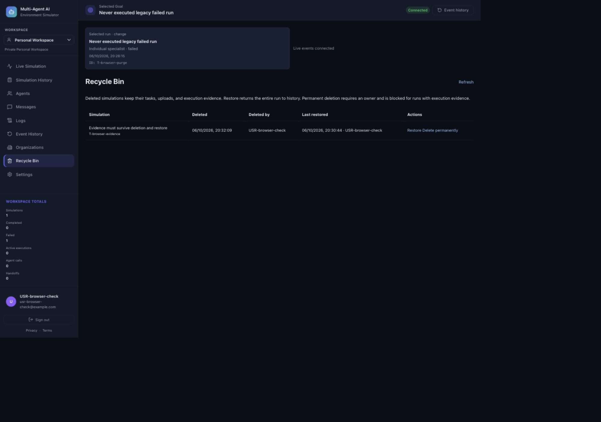

# Phase 4.8 — Recycle Bin

## Scope and baseline

The verified starting HEAD was `cdd486c`, following `fc026e1`, `c3c400b`, and
`4a82580`. Only the intentionally untracked `AGENTS.md` was present in the initial
working-tree status. Phase 4.7 documented 479 passing tests. Before implementation,
the default environment reproduced 444 passing tests and 35 opt-in PostgreSQL
skips; the final acceptance run also enables those local PostgreSQL gates.

The existing application stores a simulation, its authoritative Task, stages,
route plan, messages, activities, events, metrics, and upload links as one run
aggregate. There was no existing public destructive-delete endpoint or documented
broader recycle-bin entity catalog. This implementation therefore recycles
**simulations and their entire Task/evidence aggregate**. Tasks and stages are not
independently deletable. Users, memberships, human roles, workspaces, benchmark
datasets, agent definitions, and standalone/shared uploads are outside this scope.

The user explicitly selected preservation of execution evidence, including when
permanent deletion is requested. This is an intentional acceptance rule, not a
missing purge implementation.

## Lifecycle and permissions

- Completed and failed simulations may be moved to the bin. Queued/in-progress
  runs return a conflict; recycling never cancels execution or provider calls.
- Soft deletion changes only relational lifecycle metadata. The Task JSON,
  StageExecution and RoutePlan contracts, child evidence, and upload links remain
  unchanged. Deleted simulations disappear from active task/simulation details,
  lists, exports, events, messages, activity, metrics, and checkpoint authorization.
- Restore clears `deleted_at` and records the restore timestamp and actor. The
  last deletion actor and last restoration metadata remain available on subsequent
  recycling. Restore preserves the simulation/task ID and checkpoint identity.
  It neither reruns execution nor changes its status.
- Personal workspace owners and Organization owners/admins have
  `recycle_bin.manage` (list, soft delete, restore). Only owners have
  `recycle_bin.purge`. Ordinary members and HR-domain assignments do not grant
  either permission. Historical `owner_id` does not override workspace IAM.
- Every bin repository operation rechecks an active user, active workspace,
  personal ownership or active Organization membership, and IAM permission inside
  its tenant transaction. The normal authenticated workspace preflight also runs.
- No expiry, scheduled purge, empty-all operation, automatic destructive cleanup,
  or separate child restoration is implemented.

Permanent deletion requires an already-deleted, terminal run and a strict JSON
boolean confirmation. It is blocked for completed runs, started/measured runs,
outputs, evaluation evidence, any stage/message/activity/event rows, and relational
task/metrics evidence even if missing from the Task payload. All research graph
modes (Single/Fixed/Adaptive) are protected conservatively because their dedicated
checkpoint store cannot be safely inspected/deleted using application credentials.
Thus purge is limited to never-executed failed legacy specialist runs with no
execution evidence or potential graph checkpoint. It removes the parent plus its
Task, empty metrics, and upload associations through existing foreign-key cascades;
shared uploads themselves remain intact. The application does not request or use
checkpoint credentials for any recycle-bin operation.

PostgreSQL row locks serialize saves and lifecycle mutations. SQLite lifecycle
mutations acquire an immediate write transaction. Conditional updates prevent
concurrent delete/restore transitions from succeeding twice. Task saves reject
deleted parents, including a conditional write guard against stale writers.

## API

All endpoints require the existing application session. `X-Workspace-Id` selects an
accessible workspace; omission uses the existing Personal Workspace resolution.
Responses use camelCase and errors retain the existing FastAPI `detail` contract.

| Method | Path under `/api/v1` | Permission | Result |
| --- | --- | --- | --- |
| DELETE | `/simulations/{id}` | `recycle_bin.manage` | Soft-delete summary |
| GET | `/recycle-bin` | `recycle_bin.manage` | Deleted summaries, newest deletion first, ID tie-break |
| POST | `/recycle-bin/simulations/{id}/restore` | `recycle_bin.manage` | Restored summary |
| DELETE | `/recycle-bin/simulations/{id}` | `recycle_bin.purge` | Permanent-deletion acknowledgement |

The permanent-delete body is `{"confirmPermanentDeletion": true}`. Missing body,
missing/false confirmation, strings, or numbers cannot authorize permanent deletion.

Summaries contain `id`, `entityType`, `title`, `status`, `deletedAt`,
`deletedByUserId`, `restoredAt`, and `restoredByUserId`. No raw execution output or
uploaded context is returned by the bin list. A restore response has null
`deletedAt`. Actor IDs identify the actual authenticated user, never a client body.

- 401: no valid application session.
- 404: unavailable/foreign workspace, foreign or missing simulation. An active
  detail/export/resume request for a deleted run also returns 404.
- 403: accessible workspace but insufficient IAM permission; transaction-time
  revocation also fails closed.
- 409: `already_deleted`, `not_deleted`, `simulation_busy`, `lifecycle_conflict`,
  or `execution_evidence_retained`.
- 422: malformed request or `confirmation_required`.

## Database and security

Schema version **10** adds nullable string columns to `simulations`:
`deleted_at VARCHAR(40)`, `deleted_by_user_id VARCHAR(80)`,
`restored_at VARCHAR(40)`, and `restored_by_user_id VARCHAR(80)`.
Timestamps are timezone-aware UTC ISO strings, matching existing storage.
`ix_simulations_workspace_deleted` indexes the workspace/deletion fields.
Existing supported schema versions migrate additively; version 9 migration and
repeated initialization are verified on both SQLite and PostgreSQL. SQLite updates
both `schema_version` and `PRAGMA user_version`. No payload rewrite or historical
run claim is performed.

There are **no new tenant-owned tables**. Existing FORCE RLS remains installed on
`simulations` and its child data plane, uploads, and workspace/IAM tables. Bin reads
and writes use transaction-local tenant context and explicit workspace predicates;
SQLite receives the same application IAM checks. RLS isolates tenants; bin action
permissions additionally use the central application RBAC policy. Direct database
access is not a separate member-facing API. Checkpoint FORCE RLS and task-bound
reauthorization remain unchanged, and runtime activation stays disabled by default.

## Frontend

Simulation History exposes a terminal-run “Move to bin” action for managers.
Recycle Bin appears in navigation and provides a workspace-scoped list, actor and
UTC-derived local display timestamps, restore, refresh, empty/loading/error states,
and owner-only permanent-delete controls. Both delete actions use the existing
native modal component with focus containment, dismissal, cancellation, disabled
busy controls, and a clear preservation/irreversibility explanation. Backend
permissions remain authoritative after role changes.

Complete active-list refreshes now remove omitted/deleted runs while retaining
newer event snapshots for runs still present. A local creation acknowledgement made
during an older in-flight refresh survives that omission until the next complete
list. Workspace switching discards stale bin responses and pending purge dialogs.

Browser acceptance used a disposable SQLite database, a localhost-only synthetic
session fixture outside the repository, and no provider keys. Verified soft delete,
cancellation, restore to history, repeat deletion retaining restoration metadata,
permanent-deletion confirmation cancellation, and switching to an empty Organization.
Actual permanent deletion and protected-evidence rejection are integration-tested;
no user application run was purged in browser testing.

## Changed files

Backend implementation:

- `backend/app/api/routes/recycle_bin.py`
- `backend/app/main.py`
- `backend/app/models/schemas.py`
- `backend/app/security/rbac.py`
- `backend/app/storage/database.py`
- `backend/app/storage/models.py`

Backend tests:

- `backend/tests/test_recycle_bin.py`
- `backend/tests/test_recycle_bin_postgres.py`
- Schema-version expectations in `test_auth_storage.py`,
  `test_data_plane_rls_activation.py`, `test_hr_human_roles.py`,
  `test_membership_role_management.py`, `test_organization_membership_storage.py`,
  `test_simulation_workspace_storage.py`, `test_upload_tenant_ownership.py`, and
  `test_workspace_storage.py` under `backend/tests/`.

Frontend:

- `frontend/src/App.jsx`
- `frontend/src/components/common/ConfirmRecycleAction.jsx`
- `frontend/src/hooks/useSimulationData.js`
- `frontend/src/layout/Sidebar.jsx`
- `frontend/src/pages/TaskSummary.jsx`
- `frontend/src/pages/RecycleBin.jsx`
- `frontend/src/services/apiClient.js`
- `frontend/src/utils/recycleBin.js`
- `frontend/src/utils/runs.js`
- `frontend/tests/recycle-bin.test.js`

Documentation: this file and `docs/screenshots/phase48-recycle-bin.png`.

## Local acceptance — 2026-10-06

- Final full backend suite: **526 passed, 0 failed, 0 skipped**, 2 existing
  LangChain/Starlette deprecation warnings, 57.90 seconds. This includes all
  original 479 tests plus 47 recycle-bin cases, with both restricted local test
  connection variables and the existing checkpoint SQL opt-in configured.
- Frontend: **76 passed, 0 failed, 0 skipped**. Production build passed. Oxlint
  passed with only the 2 existing Fast Refresh warnings in SimulationContext and
  AppShell. No new dependencies were installed.
- Python compilation of `backend/app` and `backend/tests` and `git diff --check`
  passed. Browser checks above exercised real frontend/API integration.
- Dedicated bin cases cover SQLite/PostgreSQL migration, exact payload and
  relational-evidence preservation, cross-tenant IDs, missing/conflicting items,
  authenticated API error contracts, owner/admin/member permissions, revoked
  membership, concurrent SQLite transitions, shared-upload preservation, strict
  confirmation, failed/completed evidence protection and relational drift, and
  actual PostgreSQL checkpoint preservation for all three graph modes.
- The PostgreSQL test connection uses a fresh restricted schema-creating login;
  the checkpoint connection uses a fresh restricted login with access only to the
  existing local checkpoint schema. No existing runtime credentials were changed.
  Test-owned schemas/threads are cleaned by their fixtures. The private password
  file/session manifest were removed and both new test logins were disabled.
- No application record was permanently deleted outside disposable test fixtures.
  No production credentials, Railway changes, provider calls, pushes, deployments,
  runtime activation, or later-phase work occurred. `AGENTS.md` remains untracked
  and untouched.

**Phase 4.8 local acceptance is complete.** There are no remaining local acceptance
blockers. Evidence-bearing permanent deletion remains intentionally unavailable
under the user's selected preservation policy. Production migration/deployment
has not been performed or authorized by this work.
