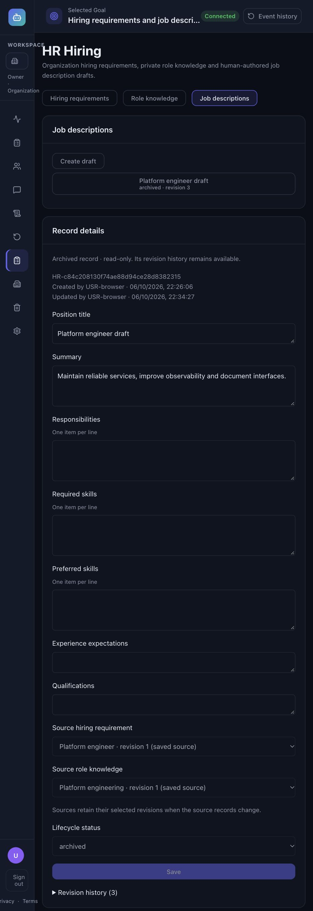

# Phase 5 local acceptance report

**Completed:** 7 October 2026 (Asia/Kolkata). Backend consolidated acceptance and
browser acceptance completed on 6 October; final frontend checks, cleanup and
commit preparation were completed after the interrupted session resumed.

**Result:** Phase 5 is locally complete. Phase 6 may be planned separately, but
was not started. Production deployment acceptance is still gated.

## Starting state and preservation

Verified starting HEAD: `43362bf`, matching the Phase 4 report. Only untracked
`AGENTS.md` was present before implementation. On resumption, HEAD was still that
commit and all Phase 5 changes remained in the working tree. No implementation
was restarted. The saved consolidated backend result already showed 635 passes;
only frontend lint cleanup, resource cleanup, documentation and commits remained.

The existing Phase 4 tests continue to pass. Their schema-version and table/policy
inventory assertions were updated for the additive version-12 schema. Checkpoint
tests gained an optional isolated test-schema setting; production execution and
security contracts did not change. No dependency reinstall or new provider call
was needed. AGENTS.md was neither edited nor staged.

## Delivered functionality

Persistent organization-owned requirements, organization role knowledge and
human-authored description drafts now have real create/list/detail/edit/history
APIs and an integrated HR Hiring page. All records carry lifecycle and actor/time
metadata. Requirements enforce bounded structured fields and opening counts.
Knowledge and descriptions preserve immutable revisions. Description sources are
pinned to exact requirement and optional knowledge revisions through composite
tenant foreign keys. Lifecycle transitions and optimistic updates are enforced.
Archival retains history and makes records read-only.

See [domain, API, database and permission contracts](PHASE5_HIRING_FOUNDATION.md).
Six tables are added by the existing additive initialization/migration mechanism,
raising operational schema version to 12. SQLite history guards and PostgreSQL
ENABLE/FORCE RLS are implemented and tested. Tests cover true V11 databases missing
HR tables, repeat initialization, preserved identities and existing execution data.

IAM plus explicit HR human permissions determine access. Active Recruiters can
manage the three foundation entities; Reviewers and Approvers can read them.
Owner/admin IAM alone does not grant HR permissions. Personal workspaces are
excluded. Revoked roles, memberships, users and workspaces fail closed. Private
organization knowledge and source relationships cannot cross tenant boundaries.
No approval, publication, candidate ranking, hiring decision or HR-agent execution
was implemented.

## Final automated results

| Check | Result | Command |
| --- | --- | --- |
| Backend, including real local PostgreSQL integration | **635 passed, 0 failed, 0 skipped** | `.venv/bin/python -m pytest backend/tests -q --tb=short` |
| Frontend forms, API contracts and existing regressions | **90 passed, 0 failed, 0 skipped** | `npm --prefix frontend test` |
| Frontend lint | exit 0; 0 errors; 2 existing warnings | `npm --prefix frontend run lint` |
| Frontend production build | exit 0 | `npm --prefix frontend run build` |
| Python compilation | exit 0 | `.venv/bin/python -m compileall -q backend/app backend/tests/test_hiring.py backend/tests/test_hiring_postgres.py backend/tests/hiring_browser_fixture.py` |
| Installed dependency compatibility | no broken requirements | `.venv/bin/python -m pip check` |
| Git whitespace validation | exit 0 | `git diff --check` |

The backend total comprises the established 592 Phase 4 tests plus 43 new HR
cases (34 API/SQLite/domain cases and 9 real PostgreSQL cases). The frontend total
comprises 84 existing tests plus 6 new hiring tests. Backend acceptance configured
`TENANT_TEST_DATABASE_URL`, `CHECKPOINT_TEST_DATABASE_URL`,
`CHECKPOINT_TEST_SCHEMA` and `RUN_LOCAL_CHECKPOINT_SQL_TESTS=1`, using private local
credentials. These values are not included in committed evidence.

Coverage includes source/revision integrity, validation, lifecycle conflicts,
owner/admin/member and Recruiter/Reviewer/Approver boundaries, missing tenant
context, Personal Workspace denial, cross-organization reads/writes, revocation,
SQLite/PostgreSQL migrations, FORCE RLS, Agent Builder, simulations, authentication,
WebSockets, worker death/recovery, checkpoint reconnect/resume and recycle-bin
restoration with execution evidence.

Initial targeted runs exposed an HR-role read failure on PostgreSQL: SELECT FOR
UPDATE on assignment rows filtered out members under the existing write policy.
Ordinary role reads now use the existing SELECT policy; permission checks and RLS
remain enforced. Other initial failures were outdated schema/policy expectations
or incomplete isolated checkpoint fixture configuration. They were corrected and
the consolidated result above has zero failures or skips. The new frontend effect
cleanup lint warning was corrected on resumption without changing request
invalidation behavior. The two remaining Fast Refresh warnings are in existing
AppShell.jsx and SimulationContext.jsx. Backend warnings are existing Starlette
and LangChain deprecation notices.

Full final output: [validation evidence](acceptance/phase5-final-validation.txt).

## Browser acceptance

The existing application was exercised in the in-app browser against the
localhost hiring fixture's disposable SQLite database. Verified:

- Personal Workspace displays the organization-only boundary.
- Recruiter creates a requirement with structured responsibilities and skills.
- Requirement editing appends revision 2 and transitions draft to active.
- Organization role knowledge is created and edited to revision 2.
- Human-authored description is created with both source revisions and edited.
- Description sources remain revision 1 after both source records reach revision 2.
- Revision history retains original and edited description content and attribution.
- Description archival appends revision 3 and disables editing, retaining history.
- Whitespace title validation rejects submission without creating another record.
- Switching to an organization without HR assignments denies even its IAM owner.
- Switching to a Reviewer organization clears prior tenant records and disables creation.
- Loading states, permission states, and validation errors display in the actual UI.

No paid provider was called. The fixture adapter raises if provider execution is
attempted. Browser acceptance did not exercise real Google sign-in or Groq calls.

## Temporary infrastructure cleanup

Verified container `fm-tenant-postgres`, database `fm_tenant_test`, bound only to
`127.0.0.1:55432`. Explicit user approval authorized restricted, expiring temporary
credentials. Runtime roles had NOSUPERUSER/NOBYPASSRLS and no bypass-role membership.
Application data used random `tenant_test_*` schemas; checkpoint data used a
separate isolated `checkpoint_phase5_*` schema and a separate runtime login with
no schema creation/table ownership/migration-table privileges.

An initial sandbox connection failure produced a detailed trace containing the
first temporary test password. It was rotated immediately before successful
acceptance. Both temporary role passwords were subsequently erased. Verified:

- `fm_phase5_acceptance`: NOLOGIN; password NULL.
- `fm_phase5_checkpoint_runtime`: NOLOGIN; password NULL.
- Zero active sessions for these roles; temporary database grants revoked.
- Zero remaining Phase 5 owned application schemas; isolated checkpoint schema removed.
- Private URL files, checkpoint-schema file and temporary provisioning/test scripts removed.
- Browser fixture stopped and its temporary SQLite directory removed.
- Frontend test server stopped; no listeners on 8019 or 5179; no Phase 5 test processes.
- Agent-created acceptance browser tab closed.

The pre-existing PostgreSQL container is retained. Existing database records and
other accounts were not deleted. The disabled role records are retained for audit.
Final evidence was checked against the temporary secrets before being committed.

## Git and remaining gates

Changes are committed locally in the three original implementation batches:
domain/persistence/security (`097de08`), APIs/lifecycle (`4896182`), and frontend/acceptance. Commit hashes
and the exhaustive file manifest are supplied with the completion response and
`phase5-changed-files.txt`. Final intended status is only `?? AGENTS.md`.

There are no remaining local Phase 5 test blockers. Real Google/Groq integration,
production migration/runtime-role verification, deployment approval and production
graph activation acceptance remain external gates. Nothing was pushed, deployed
or changed in Railway. Production graph execution remains disabled by default.
Phase 6, 7 and 8 are not claimed complete and were not started.
