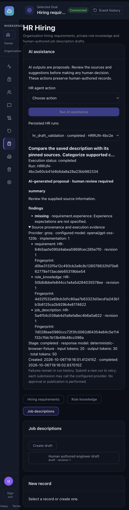

# Phase 6 local acceptance

Completed 7 October 2026 (Asia/Kolkata). Phase 6 adds real specialized HR
assistance to Phase 5. No Phase 7 approval workflow or subsequent phase is started.

## Verified starting baseline

Starting HEAD `ffab150`, following `4896182` and `097de08`, exactly matches the
reported Phase 5 commits. Only untracked AGENTS.md existed; it was never edited,
staged or deleted. Operational schema 12 and the immutable hiring revision,
human-role, provider, execution, checkpoint and RLS contracts were inspected.
Phase 4/5 architecture and saved acceptance evidence agree with those commits.

The initial backend verification with no PostgreSQL test credentials returned
575 passed, 0 failed, 60 skipped. The previous report's 635-pass claim includes
those opt-in PostgreSQL/checkpoint cases. The user approved new expiring restricted
local credentials, after which the full original regressions and new HR tests
were executed with no skips. The six system agents and existing custom-agent,
Single/Fixed/Adaptive, experiment, checkpoint and recycle-bin regressions remain
included in the consolidated suite.

## Functionality and boundaries

[Agent contracts and architecture](PHASE6_HR_AGENTS.md) document the three identities:
`hr_requirement_analysis`, `hr_jd_draft`, `hr_draft_validation`. Organization role
knowledge is integrated as an optional pinned source in these actions. Recruiters
can assess/draft; Reviewers and Approvers can validate. Holding both human roles
permits both kinds of action. IAM ownership alone grants no HR assistance.

Admission binds saved immutable revisions and validates bounded inputs. The worker
calls the existing Groq provider adapter, validates structured JSON, and preserves
Task/StageExecution lifecycle, model, measured usage, timestamps, canonical source
snapshots, fingerprints, system prompt and output schema. Generated descriptions
remain proposals in run evidence, distinguishable from authoritative human records.
Nothing automatically changes a requirement, knowledge record or saved description.

Tenant authorization is rechecked before source access, before provider invocation
and before accepting output. Revocation discards the result and retains failure
history. Private HR evidence is excluded from generic simulation SQL projections
and workspace WebSocket broadcasts. PostgreSQL FORCE RLS protects simulation roots
and inherited child evidence. Recycle-bin restoration retains source/output evidence;
purge remains prohibited. Personal Workspace, absent context, foreign sources,
revoked roles/memberships and inactive membership paths fail closed. No tools,
arbitrary file/URL retrieval, approval, publication, IAM writes, candidate ranking
or hiring decisions exist in the HR agent execution surface.

The schema remains **12**: no tables, columns or source revision migrations were
added. Existing Task JSON carries HR provenance; reviewed existing simulation RLS
is refreshed by initialization. SQLite and PostgreSQL migration/regression tests
continue to preserve historical data, and PostgreSQL reinitialization preserves
HR run evidence.

## Final validation

The final consolidated results and commands are retained in
[phase6-final-validation.txt](acceptance/phase6-final-validation.txt).

| Check | Final result | Command |
| --- | --- | --- |
| Backend with real local PostgreSQL/checkpoint acceptance | 676 passed, 0 failed, 0 skipped | `.venv/bin/python -m pytest backend/tests -q --tb=short` through private credential driver |
| Frontend | 97 passed, 0 failed, 0 skipped | `npm --prefix frontend test` |
| Frontend lint | exit 0; 0 errors; 2 existing warnings | `npm --prefix frontend run lint` |
| Production client build | exit 0 | `npm --prefix frontend run build` |
| Python compilation | exit 0 | `.venv/bin/python -m compileall -q backend/app` plus new test/fixture files |
| Dependency compatibility | no broken requirements | `.venv/bin/python -m pip check` |
| Git whitespace | exit 0 | `git diff --check` |

There are 41 new backend cases: 10 contract cases, 27 API/SQLite/worker cases and
4 real PostgreSQL worker/security cases. Seven new frontend cases cover revision
binding, historical draft sources, pending/terminal semantics, structured result
parsing, authenticated discovery/admission/polling/history, authorization errors
and screen rendering. Deterministic provider mocks are used throughout; no live
paid request was made. Missing provider credentials, provider exceptions, timeout,
malformed JSON, contract/citation errors and cancellation are tested as failures.
Usage stays null when unknown and is retained after received-but-invalid output.
Generic requests cannot impersonate an HR execution identity. Source updates after
admission retain original revisions. Role matrices, cross-tenant isolation,
revocation, history recovery and recycle-bin evidence preservation are exercised.

Early development failures were corrected before acceptance: an incorrect priority
enum, missing Reviewer assignment in a validation fixture, test-client DELETE body
syntax, and SSR test React loading. Browser layout inspection found overflowing run
selectors/fingerprints; scoped styling corrected them. No final failures or skips
remain. Existing Starlette/LangChain deprecation warnings and two pre-existing
frontend Fast Refresh warnings remain.

## Browser acceptance

Actual React frontend and FastAPI APIs were exercised in the in-app browser against
`hr_agents_browser_fixture.py`, a disposable SQLite fixture with deterministic
provider success/failure responses. Verified:

- Personal Workspace organization boundary.
- Authorized catalog and separate Recruiter/Reviewer capabilities.
- Requirement revision 1 selection while the current head is revision 2.
- Organization knowledge revision selection and optional omission.
- Assessment execution admission/progress, structured findings and source evidence.
- Proposed JD output, explicit AI/human-review labeling and real usage display.
- Validation of a saved human description against its original requirement/knowledge.
- Honest provider failure, null unknown usage and retained failed run history.
- Page reload retrieves all four persisted runs, including the failure.
- Only the original human-authored description remains at revision 1.
- Switching tenants clears sources/results/history; an IAM owner without HR roles
  is denied, while a Reviewer has validation access and disabled drafting actions.

## Local infrastructure and cleanup

Verified Docker container `fm-tenant-postgres`, database `fm_tenant_test`, exposed
only at `127.0.0.1:55432`. Approved temporary roles were NOSUPERUSER/NOBYPASSRLS,
expiring, without bypass-role membership. App acceptance created only random isolated
schemas. Checkpoint acceptance used a separate isolated schema and runtime login
without table ownership, schema CREATE or migration-table privileges. Secrets were
passed privately through stdin and a protected PGPASSFILE, never Git/chat/arguments.

After final acceptance both Phase 6 roles were set NOLOGIN with password NULL;
temporary database grants revoked, test-owned schemas removed, active sessions
checked, private files removed, and both localhost fixture servers stopped. The
pre-existing PostgreSQL container and existing database/application records remain.

## Git and external gates

Three local implementation commits cover contracts/authorization, execution/RLS
and APIs, then frontend/browser/documentation acceptance. The final response gives
their hashes; the final working tree contains only `?? AGENTS.md`.

Live Google/Groq provider integration is **unverified**; production migration/runtime
role checks, deployment and LangGraph activation remain separate gates. No push,
deployment, Railway change, live provider request or production runtime activation
occurred. Phase 6 passes local acceptance; Phase 7 may begin only as a separate
explicitly requested task.
