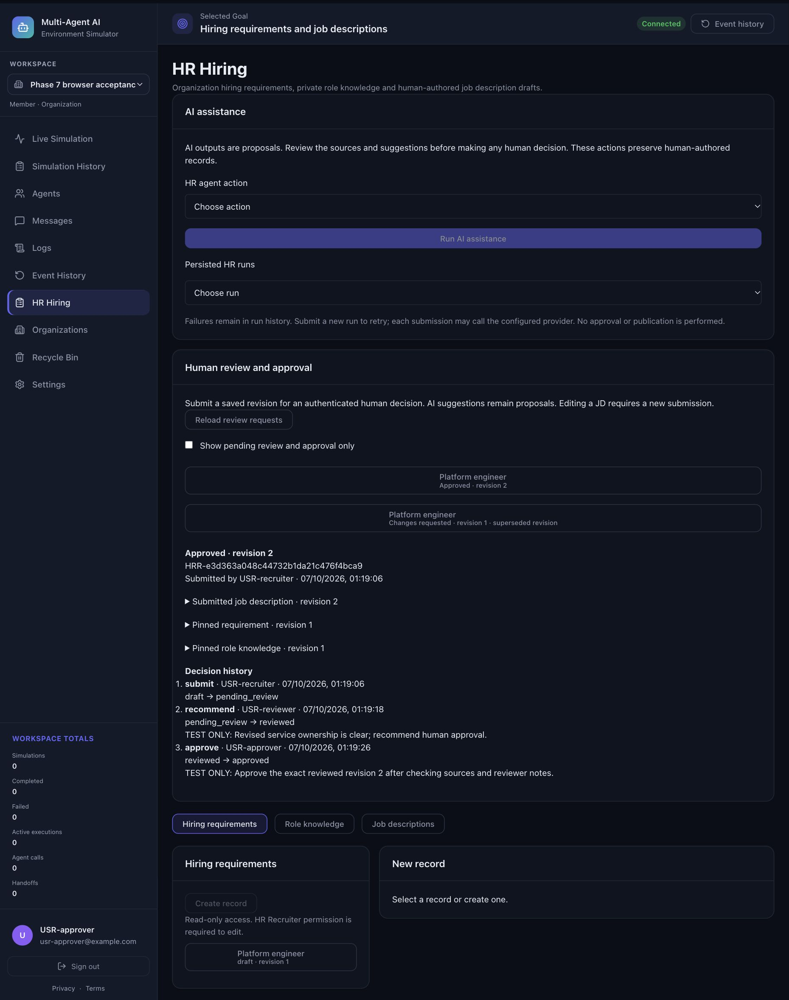
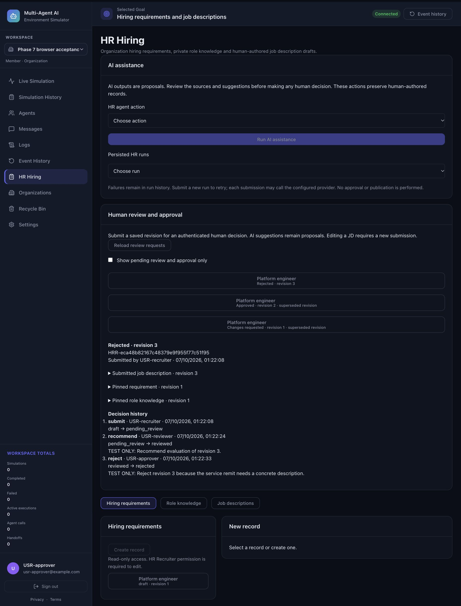

# Phase 7 local acceptance

Validated 7 October 2026 (Asia/Kolkata). This covers local Human-in-the-Loop
review, revision and approval. Phase 8 has not begun.

## Verified baseline

Starting HEAD was `f751c37`, following `8469ed0` and `4cef67d`, matching the reported
Phase 6 commits. Only `?? AGENTS.md` existed. It was read for instructions and
never edited, staged, committed or deleted. No existing uncommitted changes existed
outside that file. Phase 4–6 security, architecture and acceptance documents,
foundation models/history, human permissions, HR agents, Groq adapter,
Task/StageExecution evidence, tenant transactions and RLS were inspected.

The historical Phase 6 report records 676 backend and 97 frontend passes with
zero failures/skips, operational schema 12, and the three separate HR agent IDs.
Those original regression cases remain in final acceptance alongside the new
Phase 7 tests. Their existing schema assertions were advanced to the additive
schema 13 and RLS inventories expanded; no original behavioral test was removed.

## Delivered behavior

See [PHASE7_HUMAN_REVIEW.md](PHASE7_HUMAN_REVIEW.md) for complete API, authority,
state-machine and persistence contracts. Submitted revisions remain immutable.
`pending_review → reviewed → approved` requires recorded human review and explicit
approval. Authorized change requests and rejections are terminal. New human edits
use existing optimistic versioning, then create a distinct submission. Old approvals
never apply to the new revision. All events contain stable IDs, real authenticated
actors, UTC timestamps, notes and from/to states. Status is derived from persisted
events, not used to fabricate audit history.

Existing policies permit Approvers to review and people to hold multiple HR roles;
no inspected requirement mandates three different people. Reviewer-only users
cannot reject or approve; Approvers do not receive the Reviewer change-request
permission automatically. Final change requests need both permissions. Personal
Workspaces, IAM-only owners/admins, foreign tenants, and revoked authority fail
closed. Client actor/status claims and AI approval/publication fields are rejected.

Schema 13 adds two append-only tables with tenant-composite JD revision/submission
foreign keys, uniqueness, bounded notes, explicit transition checks and database
insertion guards. SQLite v12 migration and older migration regressions preserve
data; PostgreSQL v12 migration works both with and without the new tables, retains
source and decision history, and reinitializes safely. Both new tables enable and
force RLS. Direct SQL verifies missing-context and foreign-tenant invisibility,
revocation, actor spoofing denial, immutable history and action-specific authority.
Two real PostgreSQL connections exercise competing decisions and approval/edit races.

Completed AI runs can be explicitly associated only with matching pinned sources
(and matching JD revision for validation). Original Task/stage evidence remains
unchanged and inspectable. Association creates no adoption or approval claim.
There is no automatic content adoption; deliberate human edits use the existing
attributed JD revision history. Failed, foreign, missing, duplicated and stale
validation evidence cannot be linked. No live Groq requests were made.

## Final validation

Exact consolidated logs are saved in
[phase7-final-validation.txt](acceptance/phase7-final-validation.txt).

| Check | Result |
| --- | --- |
| Full backend, including real local PostgreSQL and checkpoint regressions | 731 passed, 0 failed, 0 skipped |
| Frontend | 105 passed, 0 failed, 0 skipped |
| Frontend lint | exit 0; 0 errors; 2 existing Fast Refresh warnings |
| Production frontend build | exit 0 |
| Python compilation | exit 0 |
| Dependency compatibility | no broken requirements |
| Git whitespace | exit 0 |

55 new backend cases comprise 18 SQLite/storage cases, 24 authenticated API cases
and 13 PostgreSQL cases. Eight new frontend cases cover eligibility and terminal
states, role combinations, exact submission revision, matching proposal evidence,
status labels, authenticated tenant APIs, conflict/revocation errors and rendering.
The existing 676 backend and 97 frontend cases cover Phase 4–6 regressions.

Development failures were corrected before final acceptance: stale schema/table
inventory assertions, a temporary overly broad text replacement in one test
(restored with no final change), and the new race fixture's PostgreSQL search-path
and idle-connection handling. The bounded race tests keep the restricted
three-connection ceiling. Connection failures now propagate honestly rather than
being converted to 409. A final direct-SQL check identified and closed an
approval-stage change-request permission gap. Its positive SQL fixture was corrected
to persist a real UTC timestamp instead of a placeholder. No final failures or skips remain.
Existing Starlette/LangChain deprecations and two frontend warnings remain.

## Actual browser acceptance

The React frontend on `127.0.0.1:5179` used the real FastAPI routes at
`127.0.0.1:8019` with disposable SQLite and three distinct test-only human sessions.
Provider responses were deterministic fixtures, not production/provider evidence.
Verified in the in-app browser:

1. Personal Workspace has no organization HR semantics.
2. Recruiter submits saved revision 1, retaining original content and pinned sources.
3. Member Reviewer inspects that snapshot, requests changes with attributed notes,
   and has no final approval or rejection control.
4. Recruiter follows Revise authoritative draft, edits through the existing versioned
   form, and submits revision 2. Revision 1 retains feedback and becomes superseded.
5. Member Reviewer recommends revision 2; Member Approver explicitly approves it.
   History displays three distinct authenticated actors and real decision timestamps.
6. Reload retrieves the approved request/history from storage.
7. Workspace switching clears all old tenant material. An IAM Owner without HR
   roles is denied, even though the same person is an Approver in the other tenant.
8. Recruiter edits approved material to revision 3. The prior approval stays on
   revision 2; revision 3 requires a fresh pending submission and recommendation.
9. Approver rejects revision 3 with reason. Revision 2's approval and revision 1's
   change request remain available in their original histories.
10. Recruiter revises rejected material to revision 4. A deterministic requirement
    assessment executes through Phase 6 APIs against explicit requirement/knowledge
    revision 1. Its completed original run is explicitly associated with revision 4.
    Source fingerprints/proposal findings are inspectable beside the unchanged human
    JD, while the submission remains pending review with only a human submit event.

## Local infrastructure and cleanup

Verified `fm-tenant-postgres`, `fm_tenant_test`, host mapping `127.0.0.1:55432`.
The pre-existing Phase 6 acceptance/runtime logins were disabled. The user explicitly
approved fresh temporary credentials before provisioning. Phase 7 logins were
NOSUPERUSER/NOBYPASSRLS/NOCREATEDB/NOCREATEROLE, expiring and connection-limited,
without administrative role membership. App tests used random `tenant_test_*`
schemas only. Checkpoint regressions used a separate isolated schema, pre-existing
checkpoint owner separation and a runtime login with only schema USAGE and bounded
DML, without CREATE/table ownership/migration-table privileges.

Passwords were generated privately, passed through stdin for provisioning and
mode-0600 PGPASSFILE in a mode-0700 temporary directory; no secrets entered Git,
chat, command arguments or logs. After acceptance the two Phase 7 logins were
set NOLOGIN/PASSWORD NULL, database grants revoked, sessions checked, test-owned
schemas removed, and all private credential files removed. Both localhost fixture
servers were stopped and the disposable SQLite data removed. Existing application
records, database container and production credentials were preserved.

## Git and remaining gates

The first two local commits are `d64d1af` (contracts/persistence/RLS) and `f22571e`
(authenticated APIs/adversarial tests). The final frontend/acceptance commit also
includes corrections found during coordinated acceptance and the added SQL/race
cases. Its hash is reported in the final response. Final working tree:
`?? AGENTS.md` only. No history was rewritten.

No push, deployment, Railway change, live paid provider call, production credential
change or production LangGraph activation occurred. Live Google/Groq integration,
production migration/runtime-role verification, deployment and graph activation
remain separate unverified gates. They do not block this local HITL acceptance.

Phase 7 is locally complete. Phase 8 may begin as a separate authorized task;
no Phase 8, 9 or 10 functionality was started.
