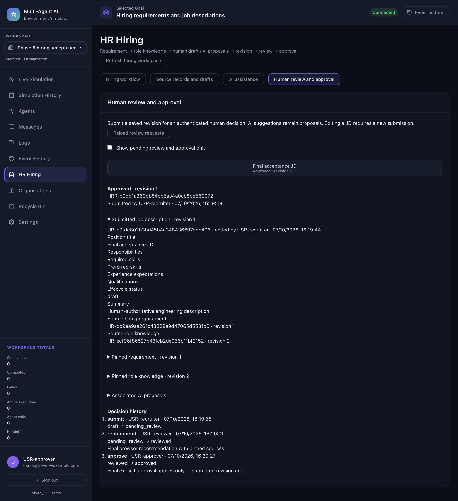
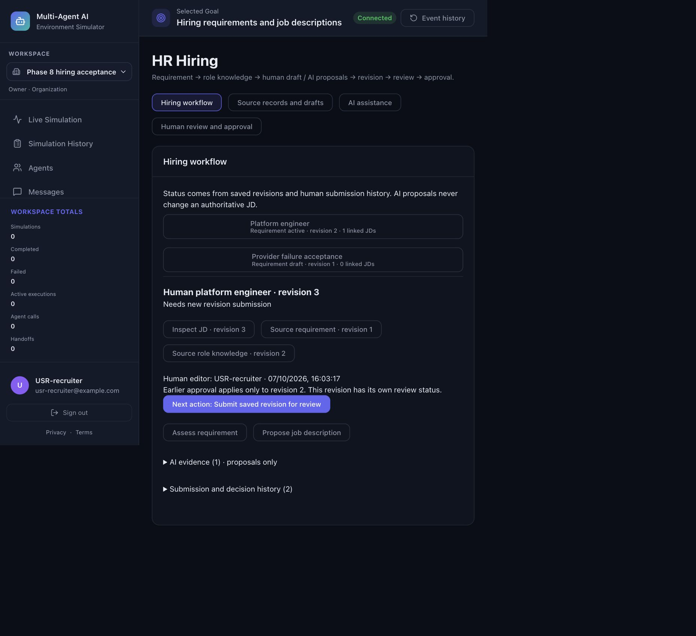
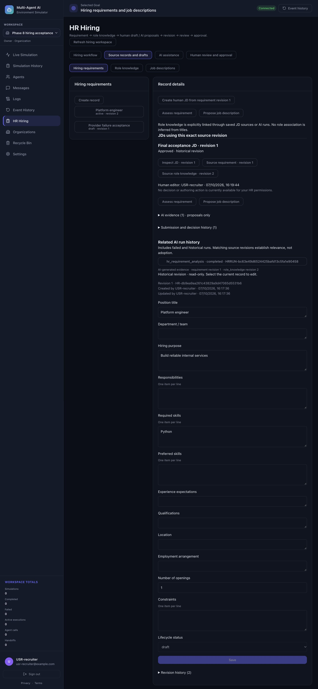
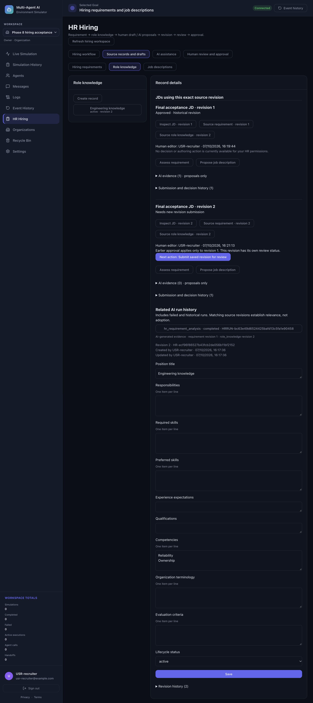

# Phase 8 local acceptance

Validated 7 October 2026 (Asia/Kolkata). Phase 8 integrates the existing HR
foundation, AI assistance and human review/approval into one organization hiring
experience. Phase 9/10 has not started.

## Verified baseline

Starting HEAD `5195d9a` followed `f22571e` and `d64d1af`, matching the reported
Phase 7 commits. Initial working tree contained only `?? AGENTS.md`. Repository
instructions, Phase 5–7 acceptance reports, HR entities/revisions, AI admission and
Task/StageExecution storage, persisted review events, API clients, workspace
switching, IAM/HR permissions, PostgreSQL tests and browser fixtures were inspected.
`AGENTS.md` was read for instructions and never changed, staged, committed or deleted.

The Phase 7 report and its consolidated log record 731 backend and 105 frontend
passes, with zero failures/skips, at schema 13. Actual repository schema version
is 13. Existing Phase 5/6 completion reports were preserved; Phase 6 already notes
that an earlier Phase 5 replay returned 575 passes and 60 skips before real
PostgreSQL gates were subsequently exercised. Historical reports were not treated
as a substitute for current testing. All 731 Phase 4–7 regression cases remain in
the final 746-case collection; no older behavioral test was removed or relaxed.

## Integrated journey and frontend

See [PHASE8_HR_INTEGRATION.md](PHASE8_HR_INTEGRATION.md) for the complete UI and API
behavior. HR Hiring now provides coherent workflow/source/AI/review navigation.
Requirements lead to deliberately authored JDs with explicit source revisions.
Current and historical JD usage can be traversed from requirements/knowledge,
including old immutable JD revisions whose current head uses different sources.
Exact JD inspection retains its own content and human editor/time.

Authorized users open requirement analysis, JD proposals or validation with saved
references. Original run status/output/failures, fingerprints and recorded stages
remain available. There is no adoption action or authoritative AI JD write.
Human submission explicitly pins a saved revision and optional matching original
AI evidence. Reviewers inspect that snapshot and record eligible recommendations
or feedback. Recruiters revise and resubmit through the original versioned editor.
Approvers make eligible explicit decisions with an accessible confirmation.

Status/next actions derive from actual submission records and existing backend
capabilities. New revisions display their own status; earlier approvals remain
attached to the earlier revision. Historical and archived revisions cannot gain
current-revision authoring/submission/decision eligibility. Refresh preserves
in-progress decision notes while validating action eligibility and clearing AI
associations when the JD revision changes. The existing shared IAM labels now
correctly show Admin membership, without conveying HR authority.

## Backend and database

Only two read-only relationship routes were added: exact requirement-revision and
knowledge-revision JD usage. They reuse `HRRecord`, existing immutable JD revision
rows, existing scope/permission checks and tenant transactions. Root and related
rows are explicitly scoped; foreign/unavailable roots and revoked authority fail
closed. No new table, column, migration, evidence store, execution system, review
system, tenant system or permission model was introduced. Schema remains **13**.

The frontend builds its workflow projection from existing authoritative APIs,
with scoped cancellation and read concurrency bounded to three. It is not a new
transactional lifecycle snapshot; write eligibility/version conflicts are still
checked by the backend at action time.

## Security

Current acceptance verifies cross-tenant lists and foreign record traversal,
personal exclusion, IAM-only owner/admin and no-HR-role denial, recruiter/reviewer/
approver/combined capabilities, revoked HR assignments and inactive memberships.
Existing PostgreSQL FORCE RLS, direct SQL/actor spoofing/immutable audit tests,
approval-versus-edit races, pooled context cleanup and checkpoint worker recovery
remain green. Three new PostgreSQL cases compose the linked journey and exact
historical source traversal under a restricted role.

Workspace switching remounts the HR subtree and discards old forms, sources,
reviews and AI selections/polling. Pending reads are aborted or generation-fenced.
The browser switched organization while a deliberately delayed old revision read
was pending; no prior JD/source information reappeared in the next workspace.
Action authorization errors re-read capabilities. UI visibility does not replace
server authorization or FORCE RLS.

## Exact final validation

| Check | Result | Evidence |
| --- | --- | --- |
| Full sequential backend, all local PostgreSQL gates enabled | **746 passed, 0 failed, 0 skipped** | [backend log](acceptance/phase8-backend-validation.txt) |
| PostgreSQL/checkpoint-focused cases within that suite, including SQL contract checks | **87 passed, 0 failed, 0 skipped** | final test collection and backend log |
| Frontend regression | **124 passed, 0 failed, 0 skipped** | [frontend log](acceptance/phase8-frontend-validation.txt) |
| Manual real-browser acceptance | **27 checkpoints passed, 0 remaining failed, 0 skipped** | [browser checklist](acceptance/phase8-browser-checklist.md) |
| Frontend lint | exit 0; 0 errors; 2 existing Fast Refresh warnings | [lint log](acceptance/phase8-lint.txt) |
| Production frontend build | exit 0 | [build log](acceptance/phase8-build.txt) |
| Python compilation | exit 0 | `compileall -q backend/app backend/tests` |
| Dependency compatibility | no broken requirements | `python -m pip check` |
| Git whitespace, staged whitespace | exit 0 | `git diff --check`, `git diff --cached --check` |

15 new backend cases comprise 12 authenticated API/journey cases and 3 real
PostgreSQL cases. 19 new frontend cases verify status/role eligibility, old approval
scope, source/evidence relationships, scoped loading/cancellation, denial/partial
read behavior, rendering and historical lookup requests, plus the corrected Admin
label. Existing Phase 4–7 cases remain intact.

Development issues were corrected before completion: the new utility needed its
Node-compatible import extension, browser native confirmation was replaced by the
existing modal, and snapshot refresh stopped clearing decision notes. Historical
source usage required the narrow read routes rather than current-head matching.
The first full run returned 741 passes and one skipped opt-in checkpoint SQL check;
the missing opt-in flag was corrected, that check passed separately, and the final
full run after the relationship changes returned 746 passes with no skips.
Transient local browser fetch errors were surfaced and recovered explicitly; the
final repeated journey completed without a fetch failure. Existing LangChain and
Starlette deprecations and two existing frontend warnings remain.

## Browser proof

The first disposable scenario covered revision 1 feedback, human revision 2,
three distinct human actors approving revision 2, newer revision 3, and explicit
rejection preserving the earlier approval. It also covered proposal/validation,
provider failure, role separation, knowledge head changes and responsive layout.
The fixture was restarted after the read routes were added; the final build was
repeated through analysis/submission/distinct recommendation/distinct approval,
new source-bound revision, historical source usage, keyboard cancellation and
workspace cleanup. The fixture always used actual authenticated APIs/storage and
deterministic provider output, never a UI-only approval simulation.

## Local infrastructure and cleanup

Verified `fm-tenant-postgres`, PostgreSQL 16.15, `fm_tenant_test`, mapped only to
`127.0.0.1:55432`. Prior Phase 5–7 test logins were disabled. The user explicitly
approved fresh local restricted test logins before their creation.

Phase 8 app/runtime roles were NOSUPERUSER/NOBYPASSRLS/NOCREATEDB/NOCREATEROLE,
NOINHERIT, expiring and limited to three connections. Application tests created
random `tenant_test_*` schemas. Checkpoint tests used an isolated schema owned by
the pre-existing NOLOGIN checkpoint owner; the separate runtime login received
only schema USAGE and DML on the three checkpoint tables, without CREATE,
ownership, migration-table access or administrative membership. The separate
opt-in SQL test creates random test objects and rolls back its entire transaction.

Credentials were generated privately, provisioned through stdin and stored only
in a mode-0600 configuration in a mode-0700 temporary directory. A private driver
passed test URLs through the process environment; no passwords entered arguments,
Git, chat or acceptance logs. Credential absence from the saved logs was checked.
After testing, both new roles were set NOLOGIN/PASSWORD NULL, grants revoked and
the isolated checkpoint schema removed. There are **0 remaining test sessions,
0 Phase 8 app-owned schemas, and 0 remaining checkpoint schema**. See
[cleanup evidence](acceptance/phase8-database-cleanup.txt). Private credential files
and drivers were removed. Both task-owned servers were stopped, disposable SQLite
fixtures removed and temporary browser/viewport state closed/reset. Existing
application records and the database container were preserved.

## Git and remaining gates

Local backend commit: `ff60b93` — revision-bound usage lookups and integration tests.
Local frontend commit: `0904f79` — unified revision-aware hiring workflow.
A final local documentation/acceptance commit includes this report, exact logs and
screenshots; its hash is reported in the final response. Final working tree is
`?? AGENTS.md` only. Existing history and local commits were preserved.

Nothing was pushed or deployed. No Railway or production database change, live
provider request, production credential change or production LangGraph activation
occurred. Live providers, production migration/runtime-role verification and
deployment remain unverified release gates. Complete histories still use existing
list APIs; pagination is a future scaling concern, not an invented Phase 8 state.

**Phase 8 passed local acceptance. Phase 9 may begin only as a separately authorized
task; it was not started automatically.**
